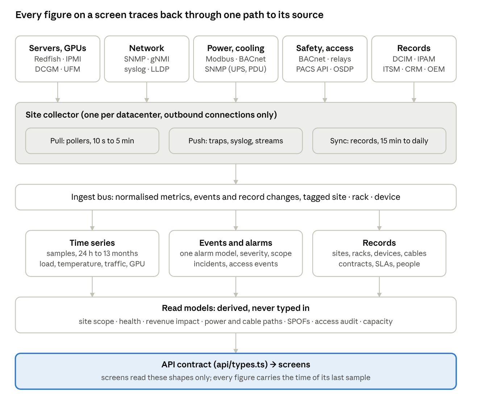

# DCO data sources and integration guide

Oct 15, 2026 · @JAYESH VERMA

## Purpose and scope

This guide names, for every figure the Datacenter Operations (DCO) screens show, the system it comes from, the protocol or API that carries it, and the arithmetic in between. The ideation prototype runs on a seeded mock (`app/src/mock/*` behind the contract in `app/src/api/types.ts`); this is the plan for replacing that mock with real collectors, written before the database design so the schema follows the data that actually arrives.

It is for the DCO product and platform team and for the customer-side teams we will integrate with (facilities, network operations, physical security, IT service management).

How to read it:

- Sections 3 to 10 describe the **source systems by class**: what equipment or software holds the data, which standard interface exposes it, and what it gives us. Every protocol statement links to its specification or vendor documentation; nothing there is assumed.
- Section 11 is the **screen-by-screen catalogue**: each KPI as shown today, the contract fields behind it, the source, the protocol, the derivation and the refresh interval.
- Section 12 and 13 hold the **normalisation rules and formulas** every screen relies on. Section 14 is the **integration point register** to plan the work from. Section 16 lists what no interface provides and must be entered by hand or decided.

Conventions: *Pull* means we poll the source; *Push* means the source sends to us (SNMP traps, syslog, Redfish events, streaming telemetry). *Interval* is the recommended collection cadence, not a product constraint. *Manual* means a person enters or imports the value (contracts, budgets, warranty dates). Vocabulary is the network persona's; the other personas only rename things.

Out of scope: the database schema, authentication and the UI, deployment topology. These follow from this document.

## How data reaches a screen

Every figure on a screen is produced along one path: a source system, a collector at the site, the ingest bus, one of three stores, a read model, and the API contract the screens already consume. The prototype today implements the last two layers (`mock/*.ts` are the read models, `api/types.ts` the contract); everything above them is what has to be built.



&#91;embedded content: data path · 5 source classes, 1 collector per site, 3 stores, read models, API\]

The collector runs inside the datacenter because almost every source speaks a protocol that must not cross the Internet (SNMP, Modbus, BACnet, IPMI) and because the facility network is normally air-gapped from the corporate one; it connects outbound only. Pull, push and sync are three different kinds of work with different failure modes, so the collector reports them separately: this is where the prototype's collector state (`Datacenter.collectors[].state` up / stale / down) and the device state `unmonitored` come from.

Freshness: each stored sample keeps the source timestamp and the collector receipt time. A screen shows a value as fresh when the last sample is younger than two polling intervals; older than that, the value is kept but shown as stale (the `Fresh` indicator in the prototype). Record data (contracts, warranty dates, badges) carries the last successful sync time instead.

## Source systems and protocols at a glance

Nine source classes feed the screens. Each speaks a small set of standard protocols, so the collector needs about a dozen readers, not one per vendor; vendor differences live in mapping tables (MIB objects, Modbus register maps, event names).

| Source class | Primary interface | Fallback / alternative | Push mechanism | Detail |
| --- | --- | --- | --- | --- |
| Network devices | SNMP v3 (IF-MIB, ENTITY-MIB, LLDP-MIB, vendor MIBs) | gNMI / OpenConfig streaming; NETCONF; vendor REST | SNMP traps, syslog, gNMI on-change | section 5 |
| Servers, storage, GPU-node chassis | Redfish over HTTPS | IPMI 2.0 | Redfish EventService, SSE, metric reports | section 4 |
| GPUs and AI fabric | DCGM exporter (Prometheus); Gaudi exporter; XPU Manager | NVML / hl-smi; host sysfs IB counters | DCGM health watches; UFM events | section 6 |
| UPS, rack PDUs, sensor hubs | SNMP (UPS-MIB RFC 1628, vendor PDU MIBs) | Modbus TCP; Redfish / JSON-RPC on newer PDUs | SNMP traps | sections 7, 8 |
| Meters, ATS, generators, DC plant, battery monitors | Modbus TCP / RTU | SNMP on some controllers; IEC 61850 on MV switchgear | none (polled) | section 7 |
| Cooling, chillers, CDUs, fire, leak | BACnet/IP or BACnet/SC through the BMS | Modbus; OPC UA; relay contacts for fire | BACnet event notifications, COV | sections 8, 9 |
| Access control, visitors, video | Vendor REST APIs | SDKs (WMI, SOAP) on older head-ends | WebSocket / SignalR, webhooks, long poll | section 9 |
| Records: DCIM, CMDB, IPAM, OEM lifecycle | REST / GraphQL | import template (xlsx) | webhooks / event rules | section 10 |
| Process and business: ITSM, paging, CRM, billing | REST | email and file exchange | webhooks | section 10 |

## Servers and BMCs

Every server, storage node and GPU node is read out of band through its baseboard management controller (BMC) over Redfish; IPMI stays only as the fallback for old hardware. Redfish gives inventory, sensors, power supplies, fans, the event log and firmware from one HTTPS endpoint, and it can push events and metric reports to the collector, so the per-server polling load stays small.

**Redfish** ([DMTF DSP0266 v1.24.0, 2026-04-02](https://www.dmtf.org/sites/default/files/standards/documents/DSP0266_1.24.0.pdf)): a RESTful interface with JSON payloads over HTTPS (TLS 1.2 or later is mandatory). Authentication is HTTP Basic or a Redfish session: POST to `/redfish/v1/SessionService/Sessions` returns an `X-Auth-Token` for later requests; client-certificate authentication also exists. The collector should use sessions, one per BMC, renewed on expiry.

| What we need | Redfish resource | Notes | Source |
| --- | --- | --- | --- |
| Model, serial, BIOS, CPU and memory summary, NICs, drives | `ComputerSystem` (v1\_29\_0) with `Processors`, `Memory`, `Storage`, `EthernetInterfaces`, `NetworkInterfaces`, `PCIeDevices` | inventory for the Equipment, Assets and DCIM screens; `SerialNumber` is what the device record is reconciled on | [ComputerSystem](https://redfish.dmtf.org/schemas/v1/ComputerSystem.json) |
| Inlet / outlet / CPU temperatures, fans | `Chassis` → `ThermalSubsystem` (v1\_5\_0) + `ThermalMetrics` (v1\_3\_3), or the `Sensors` collection (`Sensor` v1\_14\_0) | the older `Thermal` resource is deprecated since Chassis v1\_15\_0 / Thermal v1\_7\_0 (release 2020.4); collectors must read both forms, BMCs in the field differ | [Chassis](https://redfish.dmtf.org/schemas/v1/Chassis.v1_28_0.json), [Thermal](https://redfish.dmtf.org/schemas/v1/Thermal.v1_7_3.json) |
| Power supplies (state, input W, input voltage), chassis power | `PowerSubsystem` (v1\_2\_0) → `PowerSupplies` (`PowerSupply` v1\_8\_0, `PowerSupplyMetrics` v1\_3\_0); `EnvironmentMetrics` (v1\_7\_0) for chassis power and energy | gives the per-PSU state the Power & cabling tab shows (`PowerCord.state` psu-failed) and the per-server draw when the rack PDU has no outlet metering; the older `Power` resource is deprecated the same way | [PowerSubsystem](https://redfish.dmtf.org/schemas/v1/PowerSubsystem.json), [Power](https://redfish.dmtf.org/schemas/v1/Power.v1_7_3.json) |
| GPU presence and metrics on the host side | `Processor` (v1\_24\_0) with `ProcessorType` = GPU and its `Metrics` link (`ProcessorMetrics` v1\_7\_1) | board-level view only; the per-GPU counters come from DCGM (section 6) | [Processor](https://redfish.dmtf.org/schemas/v1/Processor.v1_24_0.json) |
| Hardware event log (SEL) | `Manager` (BMC) → `LogServices` → `LogEntry` (v1\_22\_0); `EntryType` = Event, SEL, OEM, CXL | the legacy IPMI SEL is exposed here too, so one reader covers both | [LogEntry](https://redfish.dmtf.org/schemas/v1/LogEntry.v1_22_0.json) |
| Push of alerts | `EventService` (v1\_12\_0): subscriptions (`EventDestination` v1\_17\_1, protocols Redfish, Kafka, SNMP v1/v2c/v3, SMTP, syslog) and server-sent events on `ServerSentEventUri` | the collector subscribes once per BMC with its own HTTPS endpoint as the destination; SSE is the fallback where inbound connections to the collector are not allowed | [EventService](https://redfish.dmtf.org/schemas/v1/EventService.v1_12_0.json) |
| Streamed metrics | `TelemetryService` (v1\_4\_1): `MetricReportDefinition` + `MetricReport`, delivered by subscription or on the metric-report SSE stream | replaces polling of sensors where the BMC supports it (iDRAC9 with the Datacenter licence does) | [TelemetryService](https://redfish.dmtf.org/schemas/v1/TelemetryService.json) |
| Firmware versions | `UpdateService` (v1\_17\_1) → `FirmwareInventory` (`SoftwareInventory` v1\_15\_0) | BIOS, BMC, NIC, drive firmware for the lifecycle and drift checks | [UpdateService](https://redfish.dmtf.org/schemas/v1/UpdateService.v1_17_1.json) |
| Rack PDUs that speak Redfish | `PowerDistribution` (v1\_7\_0), `Outlet` (v1\_5\_0), `Circuit` (v1\_10\_0) | newer PDUs expose outlets this way; most installed PDUs still use SNMP (section 7) | [PowerDistribution](https://redfish.dmtf.org/schemas/v1/PowerDistribution.json) |

**IPMI** ([IPMI v2.0, revision 1.1, 2013 with errata to 2015](https://www.intel.com/content/dam/www/public/us/en/documents/specification-updates/ipmi-intelligent-platform-mgt-interface-spec-2nd-gen-v2-0-spec-update.pdf)) gives the same sensors through the Sensor Data Record repository (SDR), the System Event Log (SEL) and Serial-over-LAN, over RMCP+ on UDP 623. The IPMI promoters (Dell, HPE, NEC, Intel) [stated in June 2020](https://www.intel.com/content/www/us/en/products/docs/servers/ipmi/ipmi-home.html) that no further updates to the specification are planned and pointed to Redfish. Use `ipmitool` or FreeIPMI's `ipmi-sensors` / `ipmi-sel` only for hardware whose BMC has no Redfish service.

**Vendor BMCs** (all confirmed on vendor pages): Dell iDRAC9 supports Redfish and, with iDRAC 4.0 and the Datacenter licence, telemetry streaming over SSE at `/redfish/v1/SSE` ([Dell reference tools](https://github.com/dell/iDRAC-Telemetry-Reference-Tools)); HPE [iLO 5](https://servermanagementportal.ext.hpe.com/docs/redfishservices/ilos/ilo5/ilo5_adaptation) and [iLO 6](https://servermanagementportal.ext.hpe.com/docs/redfishservices/ilos/ilo6/ilo6_adaptation) are fully Redfish-conformant with HPE extensions under `Oem/Hpe`; Lenovo [XClarity Controller](https://pubs.lenovo.com/xcc/rest_api) is Redfish-compliant (XCC3 at specification 1.22.0); [Supermicro](https://www.supermicro.com/en/solutions/management-software/redfish) enables Redfish on X10 / H11 and later platforms, full functionality under the SFT-DCMS-SINGLE licence; the [NVIDIA DGX H100 / H200 BMC](https://docs.nvidia.com/dgx/dgxh100-user-guide/redfish-api-supp.html) enables Redfish by default (DSP0266 1.7.0, schema 2019.1) with thermal, power, cooling, component health, logging and SSE events.

What the BMC does not give: the operating-system view (processes, OS memory, LLDP neighbours of the host). Where the customer allows an in-band agent, `node_exporter` (port 9100) and `lldpd` fill that in; otherwise the host's switch ports are found from the switch side (section 5).

## Network devices

Routers, switches and firewalls are read with SNMPv3 as the baseline that every device supports, and with gNMI streaming where the platform offers it, which replaces polling for counters and state. Syslog and SNMP traps carry the events. LLDP gives the device-to-device adjacency; the cabling between the ends is a record (section 10).

**SNMP.** Operations are defined in [RFC 3416](https://www.rfc-editor.org/rfc/rfc3416.txt) (Get, GetNext, GetBulk, SNMPv2-Trap, InformRequest); agents listen on UDP 161 and notification receivers on UDP 162 ([RFC 3417](https://www.rfc-editor.org/rfc/rfc3417.txt)). Security is the SNMPv3 User-based Security Model ([RFC 3414](https://www.rfc-editor.org/rfc/rfc3414.txt): HMAC-MD5-96 and HMAC-SHA-96 authentication, DES privacy) with AES-128 privacy from [RFC 3826](https://www.rfc-editor.org/rfc/rfc3826.txt). The collector uses authPriv with SHA and AES; v2c only where a device cannot do v3.

| Contract field | MIB object | Standard |
| --- | --- | --- |
| Interface.state | `ifOperStatus`, `ifAdminStatus` (admin-down) | [IF-MIB, RFC 2863](https://www.rfc-editor.org/rfc/rfc2863.txt) |
| Interface.utilPct, Link.utilPct | Δ`ifHCInOctets` / Δ`ifHCOutOctets` × 8 ÷ Δt ÷ `ifHighSpeed` (Mb/s) | IF-MIB |
| Interface.inErrors | `ifInErrors`, `ifOutErrors`, `ifInDiscards` | IF-MIB |
| Interface.flaps24h | changes of `ifLastChange`, plus linkUp / linkDown notifications (sent when `ifOperStatus` leaves or enters down) | IF-MIB |
| NetworkElement.serial, model, os; modules\[\] | `entPhysicalClass`, `entPhysicalModelName`, `entPhysicalSerialNum`, `entPhysicalFirmwareRev`, `entPhysicalSoftwareRev`, `entPhysicalContainedIn` (module tree) | [ENTITY-MIB, RFC 6933](https://www.rfc-editor.org/rfc/rfc6933.txt) |
| NetworkElement.tempC, module temperatures, fan rpm, PSU volts / amps / watts | `entPhySensorType` (celsius, rpm, voltsAC / DC, amperes, watts, percentRH…), `entPhySensorValue` with `Scale` and `Precision`, `entPhySensorOperStatus` | [ENTITY-SENSOR-MIB, RFC 3433](https://www.rfc-editor.org/rfc/rfc3433.txt) |
| Interface.peer, Link (LLDP) | `lldpRemTable`: `lldpRemChassisId`, `lldpRemPortId`, `lldpRemPortDesc`, `lldpRemSysName` (root 1.0.8802.1.1.2) | [LLDP-MIB, IEEE 802.1AB](https://mibs.observium.org/mib/LLDP-MIB/) |
| Link (BGP) state, sessions | `bgpPeerState` (idle … established), `bgpPeerFsmEstablishedTime`; notifications `bgpEstablishedNotification`, `bgpBackwardTransNotification` | [BGP4-MIB, RFC 4273](https://www.rfc-editor.org/rfc/rfc4273.txt) |
| NetworkElement.cpu, mem | vendor MIBs, e.g. FortiGate `fgSysCpuUsage` (.1.3.6.1.4.1.12356.101.4.1.3) and `fgSysMemUsage` (.4) per [Fortinet staff](https://community.fortinet.com/t5/Support-Forum/Fortigate-SNMP/m-p/255410); Cisco, Juniper and Arista CPU / memory objects to take from each vendor's MIB set per platform | vendor |
| uptimeMin, lastReboot | `sysUpTime` | SNMPv2-MIB |

**Streaming telemetry (gNMI).** The [gNMI specification v0.10.0](https://github.com/openconfig/reference/blob/master/rpc/gnmi/gnmi-specification.md) runs over gRPC. A STREAM subscription per path is ON\_CHANGE (initial values, then only changes), SAMPLE (every interval, optionally `suppress_redundant`) or TARGET\_DEFINED; `heartbeat_interval` re-sends unchanged values. We use ON\_CHANGE for interface oper-status, BGP session state, LLDP neighbours and component oper-status, and SAMPLE at 10–30 s for counters and optics. OpenConfig paths: `/interfaces/interface/state/counters` and `/oper-status`; `/components/component/state/temperature` (with alarm status and threshold), `/oper-status`, `/used-power` ([openconfig-platform](https://raw.githubusercontent.com/openconfig/public/master/release/models/platform/openconfig-platform.yang)); optics at `/components/component/transceiver/physical-channels/channel/state/input-power`, `output-power`, `laser-bias-current` and module `supply-voltage` ([openconfig-platform-transceiver](https://raw.githubusercontent.com/openconfig/public/master/release/models/platform/openconfig-platform-transceiver.yang); module temperature comes from the component's temperature, not the transceiver model); BGP at `/network-instances/network-instance/protocols/protocol/bgp/neighbors/neighbor/state/session-state`; LLDP at `/lldp/interfaces/interface/neighbors`. Platform support differs by vendor and release (Cisco IOS XR model-driven telemetry with dial-in and dial-out, Junos Telemetry Interface over gRPC and gNMI, Arista EOS `management api gnmi`, NVIDIA Cumulus NVUE); the supported path list must be checked per installed OS version during onboarding.

**Configuration and operational state.** [NETCONF (RFC 6241)](https://www.rfc-editor.org/rfc/rfc6241.txt) over SSH on TCP 830 ([RFC 6242](https://www.rfc-editor.org/rfc/rfc6242.txt)) with [YANG 1.1 (RFC 7950)](https://www.rfc-editor.org/rfc/rfc7950.txt) models, or [RESTCONF (RFC 8040)](https://www.rfc-editor.org/rfc/rfc8040.txt) over HTTPS, reads what SNMP lacks: NTP and AAA status, routing detail, running configuration for change evidence. Vendor REST APIs (Cisco NX-API, Arista eAPI, FortiOS REST monitor endpoints) are alternatives for the same data on those platforms; the prototype does not need to write configuration.

**Syslog** ([RFC 5424](https://www.rfc-editor.org/rfc/rfc5424.txt)) with severities 0 emergency to 7 debug; TLS transport is [RFC 5425](https://www.rfc-editor.org/rfc/rfc5425.txt). It is the event source for routing adjacency changes, hardware messages and configuration commits, mapped to alarms by a pattern table per vendor (section 12).

**Flow data** is not needed by any current screen; if traffic-per-customer views are added later: [IPFIX (RFC 7011)](https://www.rfc-editor.org/rfc/rfc7011.txt) or [sFlow v5](https://sflow.org/sflow_version_5.txt) (packet sampling plus counter samples, UDP 6343).

**Optics (DOM).** The receive power shown on the interfaces table, the cable-path suspect hop and the 3D port LEDs come from the transceiver's digital diagnostics: [SFF-8472 Rev 12.2](https://approvednetworks.com/content/msa/SFP-DDM-DOM_MSA.pdf) for SFP / SFP+ (temperature, supply voltage, Tx bias, Tx power, Rx power, each with alarm and warning thresholds held in the module) and [OIF CMIS 5.3 (September 2024)](https://www.oiforum.com/wp-content/uploads/OIF-CMIS-05.3.pdf) for QSFP-DD and OSFP (module temperature and supply voltage monitors, per-lane Tx bias, Tx output and Rx input power with latched high / low alarms). The switch reads them over the module's two-wire interface and exposes them through its entity sensors, vendor transceiver MIBs or the OpenConfig transceiver paths above. The suspect rule should compare Rx power with the module's own low-warning threshold, not a fixed −10 dBm.

**Reachability and latency.** The collector's ICMP echo gives loss, latency and jitter; [TWAMP (RFC 5357)](https://www.rfc-editor.org/rfc/rfc5357.txt) gives round-trip delay between two points where routers support it, for backhaul SLA checks.

**Optical transport (DWDM persona).** DWDM line systems are best read from their domain controller rather than per shelf: the [ONF Transport API (TAPI)](https://github.com/OpenNetworkingFoundation/TAPI) defines technology-agnostic interfaces for topology, connectivity, OAM, fault management, equipment inventory and notifications, with photonic (L0 WDM), OTN and Ethernet profiles; [OpenROADM](https://github.com/OpenROADM/OpenROADM_MSA_Public) publishes device, network and service YANG models (release 19.1.0). Which one a customer's controller offers decides the connector.

**Topology.** LLDP tables give each device's far-end device and port, which is how `Link` rows are built and how hosts behind a ToR are counted. LLDP cannot see patch panels, trunks or ODFs, so the structured path (`CablePath`) must come from DCIM cable records (NetBox models interfaces, front and rear ports and cables for exactly this). InfiniBand fabrics are discovered by the fabric manager instead (section 6).

## GPUs and AI fabric

The AI & GPU screens need three feeds that no single system provides: per-GPU counters from the vendor's monitoring agent, the job-to-node map and job progress from the scheduler and training framework, and the fabric's port counters from the InfiniBand or Ethernet side. The prototype's `Gpu` type was written against DCGM field names, so the first feed is a direct mapping.

**NVIDIA DCGM** ([docs](https://docs.nvidia.com/datacenter/dcgm/latest/index.html)) runs on every GPU host. The [dcgm-exporter](https://github.com/NVIDIA/dcgm-exporter) exposes the chosen fields in Prometheus text format on port 9400; the collector scrapes it every 10 to 30 s. DCGM has renamed many fields; the old names remain as aliases with the same numeric id, confirmed in [dcgm\_fields.h](https://raw.githubusercontent.com/NVIDIA/DCGM/master/dcgmlib/dcgm_fields.h) and the [field id reference](https://docs.nvidia.com/datacenter/dcgm/latest/dcgm-api/dcgm-api-field-ids.html).

| `Gpu` field in the contract | DCGM field (current name) | id |
| --- | --- | --- |
| util | DCGM\_FI\_DEV\_GPU\_UTIL\_RATIO (alias GPU\_UTIL) | 203 |
| smActive, smOccupancy | DCGM\_FI\_PROF\_SM\_UTIL\_RATIO, PROF\_SM\_OCCUPANCY\_RATIO | 1002, 1003 |
| tensorActive, dramActive | DCGM\_FI\_PROF\_TENSOR\_UTIL\_RATIO, PROF\_DRAM\_UTIL\_RATIO | 1004, 1005 |
| memUsedGb, memGb | DCGM\_FI\_DEV\_FB\_USED, FB\_FREE (total = used + free) | 252, 251 |
| tempC, hbmC | DCGM\_FI\_DEV\_GPU\_TEMP\_CELSIUS, MEMORY\_TEMP\_CELSIUS | 150, 140 |
| powerW, energyKwh24 | DCGM\_FI\_DEV\_BOARD\_POWER\_WATTS (alias POWER\_USAGE), TOTAL\_ENERGY\_CONSUMPTION (counter; 24 h = difference) | 155, 156 |
| clockMhz, memClockMhz, pstate, fanPct | DCGM\_FI\_DEV\_SM\_CLOCK, MEM\_CLOCK, GPU\_PSTATE, FAN\_SPEED | 100, 101, 190, 191 |
| throttle | DCGM\_FI\_DEV\_CLOCKS\_EVENT\_REASONS (alias CLOCK\_THROTTLE\_REASONS; bit mask: thermal, power cap, HW slowdown) | 112 |
| sbe, dbe | DCGM\_FI\_DEV\_ECC\_SBE\_VOL\_TOTAL, ECC\_DBE\_VOL\_TOTAL | 310, 311 |
| retiredPages, remapPending | DCGM\_FI\_DEV\_PAGE\_RETIRED\_SBE\_TOTAL / DBE\_TOTAL, ROW\_REMAP\_FAILED, ROW\_REMAP\_UNCORRECTABLE\_TOTAL | 390, 391, 395, 393 |
| pcieReplay, pcieRxGbs, pcieTxGbs | DCGM\_FI\_DEV\_PCIE\_REPLAY\_TOTAL, PROF\_PCIE\_RX\_BYTES, PROF\_PCIE\_TX\_BYTES | 202, 1010, 1009 |
| nvlinkErr, nvlinkRxGbs, nvlinkTxGbs | NVLINK\_CRC\_FLIT\_ERROR\_TOTAL, CRC\_DATA\_ERROR\_TOTAL, REPLAY\_ERROR\_TOTAL, RECOVERY\_ERROR\_TOTAL (sum); PROF\_NVLINK\_RX\_BYTES, TX\_BYTES | 409, 419, 429, 439; 1012, 1011 |
| xid | DCGM\_FI\_DEV\_XID\_ERROR (alias XID\_ERRORS) | 230 |

DCGM also provides the [health watches](https://docs.nvidia.com/datacenter/dcgm/latest/user-guide/feature-overview.html) (PCIe, memory, InfoROM, thermal and power, NVLink, driver, ConnectX) that feed `Gpu.health`, and the [diagnostics](https://docs.nvidia.com/datacenter/dcgm/latest/user-guide/dcgm-diagnostics.html) `dcgmi diag -r 1..4` (quick under 2.5 s, medium under 2.5 min on 4 GPUs, long under 10 min, extended under 45 min) used before a node leaves burn-in. [NVML](https://developer.nvidia.com/management-library-nvml) is the library under `nvidia-smi` and DCGM; the collector never needs it directly.

**Xid errors** are the driver's error reports in the kernel log; DCGM surfaces the last one per GPU (field 230). The [NVIDIA Xid catalogue (release 615, Sep 2026)](https://docs.nvidia.com/deploy/pdf/XID_Errors.pdf) defines the ones the screens name: 48 double-bit ECC error (GPU reset or reboot needed), 63 row-remapping event (informational), 64 row-remapping failure (reset GPU, contact support), 74 NVLink error (A100 / H100; reset or reboot, may be hardware), 79 GPU has fallen off the bus (restart the node, contact support), 94 contained memory error (restart the application), 95 uncontained memory error (reset the GPU). The rule table in `gpu-view.ts` maps these to the recommended actions.

**Scheduler and training framework.** Node state and the job → node allocation come from Slurm (REST API) or Kubernetes (pods and node conditions); step time, MFU and checkpoint timestamps do not exist in any infrastructure API. They must be exported by the training job (a metrics endpoint or log line per step and per checkpoint), which is an agreement with the AI platform team, not an integration we can build alone. This is listed as an open decision in section 16.

**InfiniBand fabric.** Port counters are defined by the InfiniBand architecture (PortCounters attribute) and readable three ways, all confirmed: on each host from `/sys/class/infiniband/<hca>/ports/<n>/counters/` ([kernel ABI](https://www.kernel.org/doc/Documentation/ABI/stable/sysfs-class-infiniband): `symbol_error`, `link_error_recovery`, `link_downed`, `port_rcv_errors`, `port_xmit_discards`), fabric-wide with [perfquery](https://manpages.debian.org/testing/infiniband-diags/perfquery.8.en.html) and [ibdiagnet](https://docs.nvidia.com/ibdiagnet-infiniband-fabric-diagnostic-tool-user-manual-v2-13-0.pdf), or from NVIDIA UFM: the [UFM Enterprise REST API](https://networking-docs.nvidia.com/ufmenterpriserestapi) (systems, ports, links, unhealthy ports, alarms, events, telemetry) and [UFM Telemetry](https://networking-docs.nvidia.com/ufmtelemetryum/1251/prometheus-endpoint-support), which serves the last sample of every counter in Prometheus, CSV or JSON format. `GpuNode.ib[].errors` = symbol errors; flapping = `link_downed` rising. Spectrum Ethernet fabrics running Cumulus expose state through the [NVUE REST API](https://docs.nvidia.com/networking-ethernet-software/cumulus-linux-516/System-Configuration/NVIDIA-User-Experience-NVUE/NVUE-API/) on port 8765, in addition to SNMP and gNMI.

**Intel accelerators.** Gaudi nodes run [hl-smi](https://docs.habana.ai/en/latest/Management_and_Monitoring/Embedded_System_Tools_Guide/System_Management_Interface_Tool.html) on the HLML library and the [Gaudi Prometheus metric exporter](https://docs.habana.ai/en/latest/Orchestration/Prometheus_Metric_Exporter.html) (port 41611): `habanalabs_utilization`, `_power_mW`, `_energy`, `_temperature_onchip`, `_memory_used_bytes`, `_clock_soc_mhz`, `_pcie_replay_count`, `_pending_rows_with_single/double_bit_ecc_errors`, `_nic_port_status`. Intel Data Center GPU Max nodes run [XPU Manager](https://github.com/intel/xpumanager) (`xpumcli`, a REST API and a Prometheus exporter): `xpum_power_watts`, `xpum_temperature_celsius`, `xpum_memory_used_bytes`, `xpum_engine_ratio`, `xpum_cache_errors`, `xpum_xelink_port_status`, plus throttle reason and memory error counters in `xpumcli dump`. Both cover the `Gpu` fields except SM occupancy, tensor-pipe activity and Xid, which are NVIDIA concepts; the screens already label the telemetry source per vendor.

**DGX health.** [NVSM](https://docs.nvidia.com/datacenter/nvsm/nvsm-user-guide/latest/using-nvsm-cli.html) (`nvsm show health`, `nvsm dump health`) gives a whole-system check count and a support bundle for RMA cases on DGX systems; it complements, not replaces, DCGM.

## Power chain

Every stage of the power path drawn on Facilities → Power has a controller with a network interface: SNMP on UPS and rack PDUs, Modbus on meters, generators, transfer switches and DC plants. The site collector polls them directly or reads them from the BMS when the facility team already aggregates them there; it never writes to them. Items marked "to confirm" were seen only in vendor search results and must be checked against the installed model's manual during the site survey.

| Stage | Typical controller | Interface | What we read | Source |
| --- | --- | --- | --- | --- |
| Utility incomer, LV switchgear, sub-meters | power meters (Schneider PowerLogic PM8000 / ION7400, Socomec DIRIS) | Modbus TCP, port 502 ([IANA](https://www.iana.org/assignments/service-names-port-numbers/service-names-port-numbers.xhtml?search=502)); IEC 61850 on some MV switchgear | kW, kWh, V, A, PF, THD per incomer and per board; breaker position | [Schneider publishes the PM8000 and ION7400 Modbus maps](https://www.se.com/us/en/faqs/FA244203/); DIRIS protocols to confirm; [IEC 61850](https://webstore.iec.ch/en/publication/6028) |
| Utility revenue meter | the utility's meter | DLMS/COSEM ([IEC 62056](https://www.dlms.com/)), usually through the utility's portal | monthly kWh for PUE reporting and the energy bill | [DLMS UA](https://www.dlms.com/) |
| Automatic transfer switch | ASCO 7000 series with a 5140 / 5170 Quad-Ethernet module; Eaton ATC-900 | Modbus TCP and SNMP v1 traps (ASCO; SNMP v2 and v3 not supported); Eaton Modbus RTU / TCP to confirm | source available, source connected, transfer events | [ASCO 5100 QEM manual](https://download.se.com/doc/PCM-UM-51405170QEM/381333-459D.pdf) |
| Generator | DeepSea DSE73xx / 74xx, ComAp InteliGen, Cummins PowerCommand, Kohler Decision-Maker | Modbus RTU or TCP (DSE GenComm register pages; ComAp Modbus TCP on 502 by default, SNMP on 161 when enabled) | running, oil pressure, coolant °C, fuel level %, battery V, engine speed, total kW, accumulated run hours, alarm conditions | [DSE GenComm](https://www.wincogen.com/wp-content/uploads/PD/Spec_Sheets/Accessories/SP-228_%20DSE7310-GENCOMM.pdf), [ComAp InteliGen 200](https://www.comap-control.com/products/gen-set-paralleling-controllers/inteligen/inteligen-200); Cummins and Kohler to confirm |
| UPS | APC / Schneider NMC3, Eaton Network-M3, Vertiv IntelliSlot Unity | SNMP UPS-MIB and vendor MIBs; Modbus; BACnet (Vertiv); traps for on-battery | output source (normal, bypass, battery), percent load, output W, estimated minutes remaining, charge remaining, battery status and temperature, input voltage, alarm table | [RFC 1628](https://www.rfc-editor.org/rfc/rfc1628.txt), [Eaton Network-M3](https://assets.tripplite.com/product-pdfs/en/networkm3.pdf) (SNMPv1/v3, REST API, Modbus over RS-485), [Vertiv Unity-DP](https://www.vertiv.com/en-us/products-catalog/monitoring-control-and-management/monitoring/liebert-is-unity-dp-communications-card/) (SNMP v1/v2c/v3, BACnet IP, Modbus TCP) |
| −48 V DC plant (network persona) | Eltek Smartpack, Vertiv NetSure NCU, Delta Orion | SNMP and Modbus (to confirm per controller) | output V, A, kW, rectifier module faults, battery voltage and current, BDFB breaker alarms | to confirm |
| Battery monitoring | Vertiv Albér BDSU, Generex BACS, Eagle Eye | Modbus and SNMP (to confirm) | string V and A, cell V, internal resistance, temperature | to confirm |
| Rack PDU | APC rPDU2, Raritan PX / Legrand, Server Technology PRO, Vertiv Geist | SNMP (PowerNet-MIB, PDU2-MIB, Sentry4-MIB, GEIST-MIB); Raritan JSON-RPC and Redfish | PDU kW and kWh, phase and branch current, breaker (OCP) status, per-outlet A, W, kWh and on/off | below |

**UPS-MIB objects** ([RFC 1628](https://www.rfc-editor.org/rfc/rfc1628.txt)) behind `UpsUnit`: `upsOutputSource` (normal 3, bypass 4, battery 5) → state; `upsOutputPercentLoad` → loadPct; `upsEstimatedMinutesRemaining` → batteryMin; `upsBatteryStatus` (normal, low, depleted); `upsBatteryTemperature`; `upsAlarmsPresent` and `upsAlarmTable` (on battery, low battery, on bypass, output overload, charger failed, fan failure and others). Traps `upsTrapOnBattery` (repeated about once a minute while on battery), `upsTrapAlarmEntryAdded` and `upsTrapAlarmEntryRemoved` give the alarm without waiting for the next poll.

**Rack PDU objects** behind `RackPdu`, `PduBank` and `PowerCord`, confirmed in the published MIBs:

| Vendor MIB | PDU / phase / bank | Outlet | Source |
| --- | --- | --- | --- |
| APC PowerNet-MIB, rPDU2 (1.3.6.1.4.1.318.1.1.26) | `rPDU2PhaseStatusCurrent` (tenths of A); device power and bank current to confirm | `rPDU2OutletSwitchedStatusState` (on / off) | [rPDU2PhaseStatusCurrent](https://mibs.observium.org/object/PowerNet-MIB/rPDU2PhaseStatusCurrent), [OutletSwitchedStatusState](https://mibs.observium.org/object/PowerNet-MIB/rPDU2OutletSwitchedStatusState) |
| Raritan / Legrand PDU2-MIB (1.3.6.1.4.1.13742; PX2, PX3, PX4, PRO3X, PRO4X) | inlet sensors by type, scaled by decimal digits | outlet sensors | [PDU2-MIB](https://mibs.observium.org/mib/PDU2-MIB/) |
| Server Technology Sentry4-MIB (1.3.6.1.4.1.1718.4) | `st4InputCordActivePower`, `st4InputCordEnergy`, `st4PhaseCurrent`, `st4BranchCurrent`, `st4OcpStatus` (breaker) | `st4OutletCurrent`, `st4OutletActivePower`, `st4OutletEnergy`, `st4OutletState` | [Sentry4-MIB](https://mibs.observium.org/mib/Sentry4-MIB/) |
| Vertiv Geist GEIST-MIB-V3 (1.3.6.1.4.1.21239) | per phase A, W, VA, PF, kWh, V | per outlet A, W, kWh | [GEIST-MIB-V3](https://mibs.observium.org/mib/GEIST-MIB-V3/) |

Raritan, Server Technology PRO4X and Legrand PDUs also expose a [JSON-RPC API over HTTPS](https://help.raritan.com/json-rpc/4.3.13/) and, since Xerus 4.0.10, a [Redfish API](https://www.legrand.com/datacenter/en/news/xerus-4010-firmware-update-now-available) (PX2, PX3, PXC, PXO, inline meters, transfer switches). The Redfish [PowerDistribution](https://redfish.dmtf.org/schemas/v1/PowerDistribution.v1_3_1.json), [Outlet](https://redfish.dmtf.org/schemas/v1/Outlet.v1_4_3.json) and [Circuit](https://redfish.dmtf.org/schemas/v1/Circuit.v1_8_1.json) schemas cover rack PDUs, floor PDUs, transfer switches, switchgear and busways with outlet A, W, kWh and breaker state, so one reader can serve servers and newer PDUs.

**Outlet metering decides the cord view.** The rack PDU drawer, the dual-fed count and policy CP-02 need to know which PSU is plugged into which outlet and whether that outlet draws. A PDU with per-outlet metering (Sentry4, Geist and metered-outlet APC / Raritan models) gives the draw per cord; the cord → outlet map itself is never discoverable and must be recorded in DCIM at installation. With bank-metered PDUs, the per-cord draw comes from the server's Redfish PSU input power instead.

**Utility and DG timing.** UPS and ATS events must carry the controller's own timestamp: the ride-through card and the revenue model use the moment the load went to battery, not the moment the collector noticed.

## Cooling and environment

Cooling plant is normally controlled by a building management system (BMS), and the right integration is to read the BMS over BACnet/IP rather than poll each unit; the unit cards then still read their own BACnet objects through it. Rack inlet temperature and humidity come from sensors on the rack PDU or a sensor hub, polled over SNMP.

**BACnet** is ANSI/ASHRAE Standard 135; the latest edition is [135-2024](https://bacnet.org/), published 31 December 2024. BACnet/IP uses UDP 47808 ([IANA](https://www.iana.org/assignments/service-names-port-numbers/service-names-port-numbers.xhtml?search=bacnet)). BACnet Secure Connect, a TLS and WebSocket datalink with certificates, came with [Addendum bj to 135-2016](https://www.ashrae.org/File%20Library/Technical%20Resources/Standards%20and%20Guidelines/Standards%20Addenda/135_2016_bj_20191118.pdf) (2019) and is what we should ask for where the BMS supports it, since plain BACnet/IP has no authentication. The collector reads Analog Input / Analog Value present values, subscribes to change-of-value (COV) on the points that drive alarms, and receives the BMS's event notifications; the exact object and service behaviour should be confirmed against the customer's BMS points list. [OPC UA](https://opcfoundation.org/about/opc-technologies/opc-ua/) (IEC 62541) is the alternative where the BMS vendor offers it.

| Equipment | Interface | What we read | Source |
| --- | --- | --- | --- |
| CRAH / CRAC (Vertiv Liebert iCOM, Schneider InRow, Stulz) | through the BMS (BACnet), or the unit's card: Vertiv IntelliSlot Unity (SNMP, BACnet IP, Modbus TCP), Schneider InRow Modbus register maps; Stulz replaced its C7000 controller by E² in April 2024 | status, supply and return air °C, setpoint, fan %, cooling output or capacity %, alarms | [Vertiv Unity-DP](https://www.vertiv.com/en-us/products-catalog/monitoring-control-and-management/monitoring/liebert-is-unity-dp-communications-card/), [Stulz](https://www.stulz.com/newsroom/stulz-cyberair-3-pro-cw-series-gets-a-new-control-system/); iCOM and InRow details to confirm |
| Chillers and plant controller | BACnet through the plant controller (Trane Tracer SC+ supports BACnet, LonTalk and Modbus) | chiller status, chilled water supply and return °C, plant kW (for the cooling share of PUE) | [Trane Tracer SC+](https://www.trane.com/commercial/asia-pacific/tw/en/products-systems/controls-building-automation-system/building-automation-systems/tracer-sc-plus.html) |
| Coolant distribution units (liquid AI racks) | vendor-dependent: CoolIT advertises Redfish, SNMP, Modbus and BACnet; Motivair BACnet and Modbus; Vertiv XDU to confirm | supply and return °C, flow L/min, pressure, pump state and speed, leak, dew point | to confirm per model |
| Room and rack sensors | Vertiv Geist Watchdog 15 (SNMP v1/v2c, JSON, XML); APC NetBotz 750 (SNMP v1 and v3, HTTPS); sensors on metered rack PDUs (same MIBs as section 7) | inlet °C, humidity, dew point | [Geist Watchdog 15](https://prod.vertiv.cn/4ad63b/globalassets/products/monitoring-control-and-management/monitoring/vertiv-geist-environmental-monitors2/vertiv-geist-watchdog-15-datasheet-en-emea.pdf), [NetBotz 750](https://www.42u.com/pdf/APC/NBRK0750/NBRK0750-Data-Sheet.pdf) |
| Leak detection rope (RLE SeaHawk, TTK, Vertiv Liqui-tect) | SNMP, Modbus or BACnet from the leak controller (to confirm per model) | leak, cable break, distance of the leak along the rope | to confirm |
| Fire panels, VESDA, suppression | read-only through the panel vendor's BACnet or Modbus gateway (Notifier, Siemens Cerberus PRO, Simplex) or supervised relay contacts | zone state, VESDA alarm level (Alert, Action, Fire 1, Fire 2) and obscuration, release panel armed / isolated / discharged | gateways to confirm per panel; [NFPA 72](https://www.nfpa.org/product/nfpa-72-code/p0072code) governs the fire alarm system itself |

**Thresholds on screens come from ASHRAE.** The [ASHRAE TC 9.9 thermal guidelines, 5th edition (2021)](https://www.ashrae.org/file%20library/technical%20resources/bookstore/supplemental%20files/therm-gdlns-5th-r-e-refcard.pdf) recommend 18 to 27 °C dry bulb at the IT air inlet, with dew point from −9 °C to 15 °C and at most 70% RH (50% where corrosion is high); class A1 allows 15 to 32 °C; the high-density class H1 recommends 18 to 22 °C. Liquid cooling classes are W17, W27, W32, W40, W45 and W+ by facility water supply temperature. The prototype's 27 °C hot limit and 18–27 °C band match the recommended envelope; its 40–60% humidity band does not, and should become the dew-point envelope above. GPU racks of class H1 need the tighter band.

**Measurement points.** The guideline's limits apply to IT equipment inlet air; the prototype takes a rack's temperature from one inlet sensor. Each rack's sensor position (front, middle height, or top / middle / bottom) is a DCIM record so the twin's heat map can be compared across racks.

## Fire, leak and physical security

Fire and leak systems reach us through the BMS (section 8): their panels are life-safety equipment and are integrated read-only, through the panel vendor's BACnet or Modbus gateway or through supervised relay contacts; we never write to them. The Access tab and the door states on Facilities → Environment come from the physical access control system (PACS) head-end, which every major vendor exposes through an API with an event stream.

**Reader to controller.** [SIA OSDP](https://webstore.iec.ch/en/publication/33414), published as IEC 60839-11-5:2020, is a bidirectional, supervised RS-485 protocol between readers and the access controller; its Secure Channel adds AES-128. The current version is [2.2.2 (October 2024)](https://www.securityinfowatch.com/industry-news/press-release/55239839/security-industry-association-sia-sia-releases-version-222-of-sia-open-supervised-device-protocol-standard). Legacy Wiegand is one-way and unencrypted ([HES](https://www.hesinnovations.com/en/about/news-articles/osdp-vs-wiegand-wiring)). This matters for the audit view: OSDP readers report tamper and cable faults, Wiegand readers do not. We do not talk OSDP ourselves; it is the evidence the access review shows.

**PACS head-end APIs** (we read events and cardholders; nothing else):

| Product | API | What we get | How events arrive | Source |
| --- | --- | --- | --- | --- |
| LenelS2 OnGuard | OpenAccess, REST / JSON (DataConduIT, WMI, is the legacy path) | access logs (granted / denied, cardholder, badge, reader), badges with status and expiry, alarms and acknowledgements | SignalR (WebSocket) push | [Honeywell OAAP](http://buildings.honeywell.com/us/en/brands/our-brands/lenels2/security-solutions/third-party-integration/oaap), [Milestone integration guide](https://download.milestonesys.com/LenelS2XPA/v3.0/Milestone-ACM-Lenel-OnGuard-User-Guide.pdf) |
| Genetec Security Center | Web-based SDK role (web services, API key from the licence) | cardholders, visitors, credentials, events | not stated on the pages opened | [Genetec docs](https://techdocs.genetec.com/r/en-US/Security-Center-Administrator-Guide-5.13/About-Web-based-SDK) |
| Software House C•CURE 9000 | victor Web Service (licensed) | statuses and events, configuration | persistent connection | [Milestone C•CURE guide](https://download.milestonesys.com/ccure9kxpa/v1.1/Milestone-ACM-CCure-9000-User-Guide.pdf) |
| Gallagher Command Centre | REST / JSON, API key, optional client certificate | cardholders and change feed, events with type and priority, doors, alarm zones, interlock groups | long poll `GET /api/events/updates` | [Gallagher REST docs](https://gallaghersecurity.github.io/cc-rest-docs/ref/events.html) |
| Brivo | REST / JSON, OAuth2 | access and audit events, access points, users, credentials, schedules | webhooks (`/event-subscriptions`) | [Brivo API](https://apidocs.brivo.com/) |
| Avigilon Alta (Openpath) | REST, JWT | access activity, entries, alarms, anti-passback areas, lockdown | REST Hooks | [Openpath API](https://openpath.readme.io/) |
| Honeywell Pro-Watch | REST + SignalR | events | SignalR | [Eocortex guide](https://doc.eocortex.com/integration/honeywell/pro-watch.htm) (product page marks it discontinued) |
| HID Origo | REST, OAuth2 | mobile credential lifecycle (not door events) | callbacks | [HID Origo API](https://doc.origo.hidglobal.com/api/) |

**Event vocabulary.** The `AccessEvent.result` / `reason` and `SecException.kind` values map onto what the controllers already emit, confirmed in the [Genetec (Mercury) event list](https://synergis-cloudlink-help.genetec.com/EN/EventsTypesForMercuryTriggers.html): Access granted; Access denied with the reason (invalid card format, unauthorised cardholder including anti-passback violation, unknown credential); Door forced open; Door held open; Duress PIN entered. Brivo names the same set differently ("Failed Access Out of Schedule", "Door Open Too Long", "Unauthorized Door Open"), so the collector keeps a per-vendor mapping table. Tailgating needs a people counter or a door sensor count against badge reads; the controller alone does not report it. Mantrap interlocks report "both doors open" as an interlock alarm relay ([Kouba MT-LDA](https://www.securityinfowatch.com/access-identity/access-control/press-release/10552683/kouba-associates-kouba-associates-releases-mantrap-system)).

**Visitors.** Escort, host and planned visit end come from the visitor system: [Envoy](https://developers.envoy.com/hub/reference/events) (REST, webhooks `entry_sign_in` / `entry_sign_out`, `invite_created`), [Proxyclick / Eptura](https://api.proxyclick.com/v1/docs/) (REST, OAuth2, `/vm/visits`, webhooks on visits), or [Sine](https://developer.sine.co/api/getting-started) (API on request). Without one, these fields come from the PACS visitor badge record.

**CCTV.** The prototype shows only the retention period and an evidence reference on exceptions. [ONVIF](https://www.onvif.org/profiles/) defines Profiles S (streaming; deprecation in progress, last conformance March 2027), G (edge recording), T (advanced streaming, motion and tamper events) and M (analytics metadata, object counting); the [ONVIF core specification](https://www.onvif.org/specs/core/ONVIF-Core-Specification.pdf) delivers events by WS-BaseNotification or the PullPoint pattern. For evidence links we integrate the video management system, not cameras: [Milestone XProtect](https://doc.developer.milestonesys.com/mipvmsapi/api-overview) has REST Events and Alarms APIs and an Events and State WebSocket (2023 R2 / R3 and later); Genetec uses the same Web SDK as its PACS; Avigilon ACC uses the Web Endpoint service (partner documentation).

**Fire and suppression** (states in the Environment tab): zone state (normal, pre-alarm, fire, fault), VESDA obscuration and alarm level, suppression release mode (armed, manual, isolated), discharged and cylinder low. Detail of the panel gateways is in section 8; inspection dates come from the maintenance record.

## Inventory, lifecycle and process systems

Records are what telemetry hangs on: without a rack, a U position, a cord-to-outlet map and a service-to-port map, a reading cannot be placed on a screen or charged to a customer. Each record has one owner system; DCO either reads it from there or is itself the owner (the decision per record is in section 16).

**DCIM and inventory.** [NetBox](https://netboxlabs.com/docs/netbox/integrations/rest-api/) has every object the screens use, confirmed in its documentation: sites, locations, racks, [devices](https://netboxlabs.com/docs/netbox/models/dcim/device/) with rack face and position, device types with component templates, interfaces, [cables](https://netboxlabs.com/docs/netbox/models/dcim/cable/) that terminate on interfaces, [front and rear ports](https://netboxlabs.com/docs/netbox/models/dcim/frontport/) (patch panels and trunks), console ports, and the [power chain](https://netboxlabs.com/docs/netbox/features/power-tracking/) power panel → power feed (primary or redundant) → device power port, with a PDU mapping its power port to many power outlets. API at `/api/` (REST, token auth) and `/graphql`; changes are pushed by [event rules and webhooks](https://netboxlabs.com/docs/netbox/integrations/webhooks/). Commercial alternatives: Sunbird dcTrack (REST API; Sunbird's own reference did not load, paths unconfirmed), Nlyte (OData REST API per Nlyte; reference behind the customer portal), Schneider Data Center Expert (public REST API since 8.1.0, served from the appliance at `/isxg/rest`, [Schneider FAQ](https://www.se.com/be/en/faqs/FA369091/)), Device42 (REST, `/api/1.0/devices/`, [Device42 blog](https://www.device42.com/blog/?p=5312)). Vertiv Trellis is [discontinued](https://www.vertiv.com/en-us/products-catalog/monitoring-control-and-management/software/trellis-platform/) and should not be planned for.

**CMDB.** ServiceNow has [CMDB classes](https://www.servicenow.com/docs/r/q4dSP2Icgr1SFv5wanVXvQ/1GLrH0vZKHQqi0lHfIjuTw) for every level: `cmdb_ci_datacenter`, `cmdb_ci_computer_room`, `cmdb_ci_rack` (rack units, units in use, power consumption), `cmdb_ci_server`, `cmdb_ci_netgear`, `cmdb_ci_ups`, `cmdb_ci_pdu` and `cmdb_ci_pdu_outlet`, `cmdb_ci_facility_hardware`, `cmdb_ci_generator_power_eq`. No cooling-specific class was found. Where the customer's CMDB is the record, DCO reconciles with it through the Table API.

**IPAM, DNS and DHCP** (the IP & Network screen and its Integrations tab): [Infoblox NIOS WAPI](https://docs.infoblox.com/download/attachments/15433773/Infoblox%20NIOS%20WAPI%209.x%20Reference%20Guide.pdf) (REST at `/wapi/v2.13.6/`, Basic or certificate auth; objects `network`, `range`, `record:host`, `record:a`, `ipv4address`, `vlan`); [BlueCat Address Manager RESTful v2](https://docs.bluecatnetworks.com/r/Address-Manager-RESTful-v2-API-Guide/Introduction/25.1.0) (hypermedia REST, Basic or Bearer); [ISC Kea](https://kea.readthedocs.io/en/latest/arm/ctrl-channel.html) (JSON commands `config-get`, `statistic-get-all`, `lease4-get-page`; since Kea 2.7.2 the DHCP servers take HTTP directly and the Control Agent was removed in 3.1.8); Microsoft DHCP and DNS through the [DhcpServer](https://learn.microsoft.com/en-us/powershell/module/dhcpserver/) and [DnsServer](https://learn.microsoft.com/en-us/powershell/module/dnsserver/) PowerShell modules; EfficientIP SOLIDserver (REST, reference behind login). NetBox also holds prefixes, IP addresses, VRFs and VLANs.

**Vendor lifecycle, warranty and support** (Assets tab, device Hardware tab, CP-06):

| Vendor | Real API | What it returns | Source |
| --- | --- | --- | --- |
| Cisco | yes, OAuth2 client credentials | EoX by product id or serial (end of sale, last date of support, end of security fixes); SN2INFO coverage and warranty end by serial (up to 75 per call); PSIRT openVuln advisories by product and version | [Cisco Support APIs](https://developer.cisco.com/docs/support-apis/), [openVuln](https://developer.cisco.com/docs/psirt/) |
| Dell | yes, OAuth2 from TechDirect | asset entitlements per service tag: ship date, service level, start and end dates | [Axonius](https://docs.axonius.com/docs/dell-techdirect), [JupiterOne](https://docs.jupiterone.io/integrations/directory/dell-asset-management) (official docs behind login) |
| HPE | only for servers onboarded to GreenLake Compute Ops Management | `server-warranty`: support state, start and end dates, level | [HPE GreenLake](https://developer.greenlake.hpe.com/docs/greenlake/services/compute-ops-mgmt/public/openapi/compute-ops-mgmt-latest/server-warranty-v1beta2) |
| Fortinet | yes, FortiCare Registration API v3 | registered units with entitlements, contracts and model end-of-support / end-of-registration dates; PSIRT only as an RSS feed | [Fortinet community](https://community.fortinet.com/forticloud-products-44/technical-tip-api-how-to-retrieve-list-of-registered-units-for-iam-users-96746), [FortiGuard RSS](https://fortiguard.com/rss-feeds) |
| Arista | CloudVision gRPC APIs (inventory, lifecycle, bug exposure), token auth | lifecycle and bug exposure for devices managed by CloudVision | [CloudVision APIs](https://aristanetworks.github.io/cloudvision-apis/models) |
| Juniper | no public read API found; Juniper Support Insights reports EOL / EOS and PSIRT exposure in a portal with CSV export | import | [JSI FAQ](https://www.juniper.net/documentation/us/en/software/jsi/jsi-faqs/lwc-jsi-faq/jsi-faq.html) |
| NVIDIA, Supermicro | no API; support portal and RMA forms | manual entry or import | [NVIDIA DGX support](https://www.nvidia.com/en-gb/data-center/dgx-systems/support/), [Supermicro warranty](https://www.supermicro.com/en/support/warranty) |

So warranty and end-of-life data is automatic for Cisco, Dell, Fortinet and Arista estates and an import (the inventory template's Asset\_Lifecycle, Model\_Lifecycle and Support\_Contracts sheets) for the rest.

**ITSM.** The [ServiceNow Table API](https://www.servicenow.com/docs/bundle/zurich-api-reference/page/integrate/inbound-rest/concept/c_TableAPI.html) (`/api/now/table/{table}`: GET, POST, PUT, PATCH, DELETE) creates and syncs incidents, problems, change requests and CMDB items; alarms can be sent to [Event Management](https://www.servicenow.com/docs/r/guxhDnVk8OUAJKLm7WZsYA/1a4Dq7_J57RHmhmhqebnCw) at `/api/global/em/jsonv2` with `source`, `node`, `type`, `resource`, `severity` (1 critical to 5 OK, 0 clear) and `message_key` for de-duplication. Jira Service Management uses [`/rest/servicedeskapi/request`](https://developer.atlassian.com/cloud/jira/service-desk/rest/api-group-request/); BMC Helix ITSM uses `/api/arsys/v1/entry/{form}` with a JWT valid for an hour ([BMC docs mirror](https://docs.helixops.ai/bin/Service-Management/IT-Service-Management/BMC-Helix-ITSM/itsm254/Developing/Integrating-third-party-applications-with-BMC-Helix-ITSM-by-using-the-platform-REST-API/Overview-of-the-platform-REST-API/)).

**On call and paging** (incident "On call and communications", Attention "On call now"): [PagerDuty Events API v2](https://docs.pagerduty.com/developer/send-alert-event) `POST https://events.pagerduty.com/v2/enqueue` with `event_action` trigger / acknowledge / resolve, `routing_key`, `dedup_key` and severity critical / error / warning / info; the REST API's [`GET /oncalls`](https://docs.pagerduty.com/developer/api/reference/rest/on-calls/list-on-calls) and `/schedules` give who is on call now. [xMatters](https://help.xmatters.com/xmapi/) has `GET /on-call` and event triggers. Atlassian Opsgenie [stopped selling on 4 June 2025 and ends support on 5 April 2027](https://www.atlassian.com/blog/announcements/evolution-of-it-operations); do not build a new integration on it.

**Customer notices.** Email over SMTP ([RFC 5321](https://www.rfc-editor.org/rfc/rfc5321)), SMS through [Twilio](https://www.twilio.com/docs/messaging/api/message-resource), [Slack incoming webhooks](https://docs.slack.dev/messaging/sending-messages-using-incoming-webhooks). For Microsoft Teams, the Office 365 connector webhooks [stopped working in May 2026](https://devblogs.microsoft.com/microsoft365dev/retirement-of-office-365-connectors-within-microsoft-teams/); use a Power Automate Workflows webhook.

**CRM, billing and contracts** (Customers, Revenue, colocation tenants): customer, contract, SLA target and premium flag from the CRM ([Salesforce REST, sObjects Account / Contract / Opportunity](https://resources.docs.salesforce.com/latest/latest/en-us/sfdc/pdf/api_rest.pdf)); the monthly charge per service from billing ([Zuora](https://developer.zuora.com/v1-api-reference/api/subscriptions/) subscriptions and invoices, [Chargebee](https://apidocs.chargebee.com/docs/api/subscriptions), [Stripe](https://docs.stripe.com/api/subscriptions), SAP S/4HANA OData). Metered power can be sent back as usage ([Zuora usage](https://developer.zuora.com/v1-api-reference/api/usage/), [Stripe meter events](https://docs.stripe.com/api/billing/meter-event)). What colocation operators bill, from published rate cards: space and power per cabinet by kW, cross-connects (one-off plus monthly), remote hands per hour, setup and expedite fees ([ICE Chicago price list](https://www.ice.com/publicdocs/Colocation_Product_Price_List.pdf), [Equinix colocation product description](https://www.equinix.com/content/dam/eqxcorp/en_us/documents/resources/product-documents/pd_equinix_colocation_product_description_en.pdf)).

**SLA credit structures differ by operator**, so the revenue model must read credit rules per contract rather than use one tier table:

| Contract | Commitment | Credit | Source |
| --- | --- | --- | --- |
| Equinix colocation | redundant power 99.999% (under 26 s a month); 15–32 °C, 8–80% RH | 1/30 of the loaded cabinet charge, plus 1/30 per full hour beyond; capped at the month's fees | [Equinix PD](https://www.equinix.com/content/dam/eqxcorp/en_us/documents/resources/product-documents/pd_equinix_colocation_product_description_en.pdf) |
| Digital Realty | redundant power 100%; cold aisle 18–27 °C, 25–65% RH | 2 days of fees for up to 30 min, 4 days to 60 min, a week beyond | [Digital Realty SLA](https://marketplaceportal.com/documents/10139/3596013/Digital-Realty-SLA-MSA+Exhibit) |
| Verizon colocation | dual feed 100%, single 99.98% | 25% of the space charge, capped at 25% | [Verizon SLA](https://www.verizon.com/business/service_guide/reg/colocation-service-SLA.pdf) |
| Lumen network services | Gold 99.99% | 10% of the monthly charge from 4.5 min, rising to 100% beyond 20 h | [Lumen SLA](https://assets.lumen.com/is/content/Lumen/lumen-service-level-agreementpdf) |
| AT&T Switched Ethernet | 99.99% per port | 10% of the monthly charge for an availability miss, 25% for a class-of-service miss | [AT&T guide](https://cpr.att.com/pdf/es/0003-0002.pdf) |

## Screen-by-screen catalogue

Every figure the prototype shows, with the contract field behind it, the system that will supply it, the interface, how it is derived and how often it must be refreshed. Figures that are pure roll-ups of rows listed elsewhere (counts, sums, percentages of the same fields) are named once at the widget level. Sections 4 to 10 give the detail of each interface.

Source abbreviations used in the tables: **BMC** = server baseboard controller (Redfish, IPMI); **DCGM** = NVIDIA DCGM exporter or the Intel equivalents; **Sched** = the job scheduler (Slurm or Kubernetes API) and the training framework; **SNMP** = device MIBs (IF-MIB, ENTITY-MIB and vendor MIBs), **gNMI** = OpenConfig streaming; **BMS** = the building management system (BACnet/IP or Modbus TCP gateway) in front of switchgear, cooling and fire; **UPS NMC** / **rPDU** = the network card of the UPS or rack PDU (SNMP, Modbus); **Meter** = revenue or sub-meters (Modbus, DLMS); **Genset** = generator controller (Modbus); **PACS** = the physical access control head-end API; **DCIM** = the inventory record (NetBox or equivalent, or this product's own records); **ITSM** = ServiceNow or equivalent; **CRM** = CRM / billing; **OEM** = vendor support API; **Manual** = entered or imported.

### Command center and Datacenters list

| Figure | Contract fields | Source | Interface | Derivation | Interval |
| --- | --- | --- | --- | --- | --- |
| Operations health gauge, band, weakest area | CC.shi, situation.band | derived | — | mean of the four area percentages; Healthy ≥ 85 and nothing breaching, Watch ≥ 60 | on change |
| Critical / High / Past SLA / premium customers affected | Incident.sev, status, detected, acknowledged, resolveSlaMin; Customer.premium; Service.status | incident store; ITSM (two-way); CRM | ServiceNow Table API (incident), CRM API | open incidents by severity; SLA clocks from detected and acknowledged timestamps against the targets per severity (a contract table) | event-driven |
| Area: Incident response | Incident.\* | incident store | — | (open − breaching) ÷ open | event-driven |
| Area: Network (links down, unreachable, edge redundancy) | Link.state, NetworkElement.icmp.state, DcSummary.edge | network devices; collector probes | LLDP-MIB + IF-MIB ifOperStatus or gNMI on-change; ICMP echo from the collector | an LLDP adjacency is "down" when either interface is not up; unreachable = 3 consecutive ICMP failures; edge = links whose far end is outside the site | 30 s (ICMP), on change (links) |
| Area: Power (UPS online, feeds normal) | UpsUnit.state, PowerFeed.status | UPS NMC; BMS (incomer / ATS) | SNMP UPS-MIB upsOutputSource, upsAlarmsPresent; Modbus registers of the ATS / incomer meter | % = (UPS online + AC feeds normal) ÷ total; Critical if any UPS on battery or in fault | 10 s (UPS traps), 30 s poll |
| Area: Cooling and environment (failed units, zones > 27 °C) | CoolingUnit.status, EnvSensor.tempC | BMS; rack / room sensors | BACnet objects of each CRAH / CRAC; sensor hub SNMP | unit Failed = unit alarm object or no communication; hot zone = inlet sensor above the ASHRAE recommended upper bound | 60 s |
| Map pins, backhaul lines | DcSummary.\*, Link.state (inter-site LLDP) | derived | — | worst open incident severity per site; inter-site links from LLDP peers in another site | on change |
| DcCard (incident variant): likely cause, impact, SLA bar, next action | Incident.rca, impact, actions | incident store + RCA engine | — | the RCA engine ranks hypotheses from correlated alarms (section 12); impact from the service path index | event-driven |
| DcCard (quiet): alarms, services, power %, cooling %, facility note | DcSummary.activeAlerts, services, powerKw ÷ powerCapKw, coolPct, facilityIssues | alarm store; CRM; meters; BMS | — | powerKw = Σ rack PDU kW (or UPS output); powerCapKw = design rating (record); coolPct = Σ unit load ÷ Σ unit capacity | 60 s |
| What is happening: top incidents, MTTR 30 d | Incident.\* | incident store | — | MTTR = mean(resolved − detected) over 30 days | event-driven |
| Who is affected: degraded services, exposed customers, status bar | Service.status, Customer.\* | service path index + CRM | CRM API for customer, service, SLA target, premium flag | status from the path index: a service is Down when its hand-off port or every path link is down, Degraded when a path element carries a major alarm or utilisation ≥ 90% | event-driven |
| Recommendations | Incident.actions, Change.status, Incident.similar | incident and change stores | — | rule set in `commandCenter()` | event-driven |
| Datacenters list: analytics strip and columns | DcSummary.\* | all of the above | — | site state Critical / Attention / Normal per `stateOf` | 60 s |
| Datacenters list: Revenue column | DcSummary.mrr, revRate, revExposed | CRM + revenue model | CRM API (monthly charge per service) | section 13 | event-driven |

### Datacenter page: header, Overview, Attention, Metrics, Power & space

| Figure | Contract fields | Source | Interface | Derivation | Interval |
| --- | --- | --- | --- | --- | --- |
| Identity (name, tier, address, coordinates, commissioning date) | Datacenter.\* | DCIM record | DCIM API / import template | record | daily sync |
| Collectors and freshness | Datacenter.collectors\[\].state, lastSeen | the collectors themselves | collector heartbeat | stale after 15 min without a heartbeat | 60 s |
| Site status, device health | DcSummary.healthScore, NetworkElement.healthScore | derived | — | section 13 | 60 s |
| KPI Power load, UPS state, feeds lost | DcSummary.powerKw, powerCapKw; UpsUnit.state; PowerFeed.status | rPDU or UPS output meters; UPS NMC; BMS | SNMP PDU MIB (per-PDU kW), UPS-MIB, Modbus | Σ rack PDU kW ÷ design kW | 60 s |
| KPI Cooling load, failed units, max zone temperature | DcSummary.coolPct; CoolingUnit.status; EnvSensor.tempC | BMS; sensors | BACnet; SNMP sensor hubs | Σ unit load ÷ capacity | 60 s |
| KPI PUE | DcSummary.pue | utility meter + IT meter | Modbus / DLMS (incomer kWh), PDU or UPS output kWh | section 13; instantaneous on the header, monthly energy ratio in reports | 60 s / monthly |
| KPI Edge links, network faults, services degraded, alarms, incidents | DcSummary.edge, linksDown, unreachable, servicesDegraded, activeAlerts, openIncidents | as the Command center | — | — | event-driven |
| Overview 3D: building, floors, rooms, racks, devices and their positions | Datacenter.floors, Rack.floor / room, NetworkElement.rackId / u / uSize | DCIM record | DCIM API (site → location → rack → device with U position) | the 3D layout is generated from the rack grid; the rack's row and grid position must be a record (DcimRack.gridX / gridY) | daily sync, plus change events |
| Overview: in service / not monitored / planned | OpsState | DCIM status + collector coverage | — | planned = record only; unmonitored = installed but no telemetry in the last 2 polls; tenant-owned = DCIM owner = tenant | 5 min |
| Overview: needs attention (rack beacons, hot inlets, draw ≥ 90%, failed cooling, hot zones, UPS) | Alert.\*, Rack.tempC, Rack.drawKw / budgetKw, CoolingUnit.status, EnvSensor.tempC, UpsUnit.state | alarm store; rack sensors; rPDU; BMS; UPS NMC | — | rules in `twin/attention.ts` | 60 s |
| Overview: power & cooling card (IT + facility kW, PUE, cooling kW, UPS online, DG kVA / fuel / runtime, battery autonomy) | Datacenter.power.*, cooling.* | meters; BMS; UPS NMC; Genset; battery monitor | Modbus (genset: fuel level %, run hours; battery monitor: string voltage, estimated autonomy), UPS-MIB upsEstimatedMinutesRemaining | DG kVA and battery Ah are nameplate records; fuel % and runtime are live | 60 s |
| Room panel: environment °C / RH / smoke / leak | EnvSensor.\* | sensors; fire panel; leak controller | SNMP or Modbus sensor hubs; BACnet / relay from the fire panel; leak controller SNMP or Modbus | smoke = fire panel alarm state for the zone; leak = leak controller alarm for the zone | 60 s (env), event (fire, leak) |
| Rack panel: U used / free, draw vs budget, inlet, ports used | Rack.usedU, heightU, drawKw, budgetKw, tempC, portsUsed, ports | DCIM record (U, budget, ports); rPDU (draw); rack inlet sensor | SNMP PDU MIB per-PDU power; sensor on the PDU or hub | draw = PDU A + PDU B kW; inlet = the rack's front sensor (middle height) | 60 s |
| Rack panel: power feeds (A + B → UPS) | RackPdu.upstreamId | DCIM record (panel → feed → PDU chain) | DCIM power-panel / power-feed objects | record; the prototype's frozen panel shows the site's first two UPS, which is wrong for 4-UPS sites | daily sync |
| Equipment panel: health, role, model, OS, serial, IP, MAC, CPU, memory, chassis °C, links | NetworkElement.\* | SNMP / Redfish; DCIM | SNMP sysDescr, ENTITY-MIB serials, vendor CPU / memory MIBs; Redfish Systems + Chassis for servers; gNMI /components | section 5 and 4 | 5 min (inventory), 60 s (load) |
| Realistic twin path card: feed → UPS → busway → PDU; PSU cords; trunks; device cables | RackPdu, PowerCord, Trunk, CablePath | DCIM record; rPDU per-outlet state; Redfish PSU state | DCIM power-port → outlet links, cable / front-port / rear-port objects; PDU MIB outlet state; Redfish PowerSupplies | the chain is a record; states come from telemetry | daily sync + 60 s |
| Attention: facility panel, on call now, SPOFs, changes, risks, monitoring gaps | Datacenter.power / cooling; OnCall; Spof; Change; Datacenter.risks; OpsState | as above; on-call tool; change store; risk register (manual) | PagerDuty / Opsgenie on-call API; ITSM change table | SPOFs derived from the PDU / cord / cooling / trunk records and states (section 13) | 5 min |
| Metrics: zone temperature / humidity 24 h, load 24 h, cooling 24 h, battery hours, diesel litres | EnvSensor, Datacenter.power.load24h, cooling, dg.fuelPct | sensors; meters; BMS; Genset | time-series store | the 24 h curves are stored samples (the prototype synthesises them); diesel litres = tank capacity record × level % from the genset controller or a tank level sensor | 60 s |
| Metrics: hardware fault indicators (fans, PSUs, fault LEDs), device load (CPU, memory, temperature) | NetworkElement.modules, cpu, mem, tempC | SNMP (ENTITY-MIB, ENTITY-SENSOR-MIB, vendor); Redfish (Thermal / Power / Sensors) | section 4, 5 | module state from entPhysical / entStateOper or Redfish Status.Health | 60 s |
| Power & space: power feeds table (rating, load, status) | PowerFeed.\* | BMS incomer meters; ATS | Modbus (PM-series meters: kW, kWh, V, A, PF) | rating = record; load live | 60 s |
| Power & space: where the power goes (IT / cooling / other) | Datacenter.power.split | meters | sub-meters on the mechanical board and the UPS output | other = total − IT − cooling | 60 s |
| Power & space: rack space, ports by class, compute pool | Rack.usedU, Datacenter.ports, compute | DCIM record; SNMP ifTable (port classes); virtualisation / OS inventory | DCIM API; IF-MIB ifType / ifHighSpeed | used ports = interfaces with a cable record or ifOperStatus up | daily / 5 min |
| Power & space: backup rows (DG, battery, UPS modules, AC / DC kW) | dg, battery, ups\[\], acKw, dcKw | Genset; battery monitor; UPS NMC; rectifier controller | Modbus; UPS-MIB; rectifier controller SNMP / Modbus (−48 V plant kW) | — | 60 s |

### Facilities (Power, Cooling, Environment, Single points of failure, Maintenance)

| Figure | Contract fields | Source | Interface | Derivation | Interval |
| --- | --- | --- | --- | --- | --- |
| Power path: utility nodes (load, rating, Live / Standby / Lost) | PowerFeed.loadKw, capacityKw, status | incomer meters; ATS / switchgear | Modbus TCP (meter kW, breaker position); BACnet from the BMS | Lost = incomer breaker open or voltage absent; Standby = healthy at 0 kW | 10 s |
| Power path: DG set (kVA, fuel %, runtime, test result; Pending / Standby) | dg.\* | Genset controller | Modbus (engine running, fuel level, run hours, kW, alarms) | kVA = nameplate record; runtime at present load = fuel litres ÷ consumption curve; last test and result from the PM record | 30 s |
| Power path: ATS state | derived | ATS controller | Modbus (source available / connected) | On utility / On alternate / No source | 10 s |
| Power path: LT panel, rectifier, battery | split, dcKw, battery.\* | main LV meter; rectifier controller; battery monitor | Modbus; rectifier SNMP / Modbus (output V, A, kW, module faults); battery monitor Modbus (string V, cell V, internal resistance, temperature) | autonomy from the controller's estimate or Ah × V ÷ load | 30 s |
| Power path: UPS modules (load %, redundancy, battery min, state) | UpsUnit.\* | UPS NMC | SNMP UPS-MIB (upsOutputPercentLoad, upsEstimatedMinutesRemaining, upsOutputSource, upsAlarm table) + vendor MIB | redundancy N / N+1 / 2N is a design record | 10 s, traps |
| Site load 24 h, 12-month history, growth | load24h, history12m | meters | time-series store | peak = max; growth = (m12 − m1) ÷ m1 | 60 s |
| If utility power fails: steps and checks | UpsUnit.batteryMin, dg.\*, battery.lastTest, PowerFeed.status | as above + PM records | — | section 13; the DG test and battery test ages come from the PM plan | 60 s |
| Cabinet power distribution: PDUs, cords, dual-fed, single-fed, PDUs needing attention | SitePhysical.totals, RackPdu.state / note | DCIM record (PDU, outlets, cord map); rPDU | SNMP PDU MIB: per-PDU kW, per-bank A and breaker state, per-outlet state and W | dual-fed = device with live cords on both A and B; tripped = breaker state from the PDU; on battery = upstream UPS state | 60 s |
| If one side fails; what-if simulation | WhatIf.\* | derived | — | each side rated for the cabinet budget; simulation over the cord map | on demand |
| Rack power table (draw / budget, PDU A · B dots, inlet, state) | Rack.*, RackPdu.* | rPDU; sensors; DCIM | as above | thresholds 75 / 85 % | 60 s |
| Rack PDU drawer: model, banks (load A of breaker A), outlet map, device cords (PSU → outlet, W, feed) | RackPdu.model, PduBank.*, PowerCord.* | DCIM record; rPDU per-outlet metering; BMC PSU state | SNMP PDU MIB outlet W; Redfish PowerSupplies (state, input power) | cord → outlet map is a DCIM record (power-port to power-outlet); W per cord from outlet metering when the PDU meters outlets, else from Redfish PSU input power | 60 s |
| Cooling: heat balance (heat to remove, running capacity, with one more lost, installed) | cooling.loadKw, capacityKw, redundancy, CoolingUnit.\* | BMS; rPDU (heat = IT kW) | BACnet (unit status, cooling output kW or capacity %, supply / return °C) | section 13 | 60 s |
| Cooling: unit cards (load %, supply, return, ΔT, zone) | CoolingUnit.\* | BMS or the unit's own card | BACnet / Modbus / SNMP (Liebert iCOM, Schneider InRow and similar) | ΔT = return − supply | 60 s |
| Cooling: coverage by floor, dependent racks, nearest unit | CoolingZone.*, RackCooling.* | DCIM record (unit → room) + BMS | — | zone = floor; nearest unit = record (or distance on the floor grid) | 60 s |
| Environment: zone cards (temperature, humidity bands, smoke, leak) | EnvSensor.\* | sensors; fire panel; leak controller | SNMP / Modbus sensor hubs; BACnet or relay contacts (fire); SNMP / Modbus (leak) | bands 18–27 °C and 40–60 % RH follow the ASHRAE recommended envelope (section 8) | 60 s, event |
| Environment: fire detection and suppression (detector state, obscuration, agent %, release mode, inspection) | FireZone.\* | fire alarm panel; VESDA; suppression release panel; PM records | BACnet / Modbus gateway from the panel (zone state, trouble); VESDA Modbus / BACnet (obscuration % / m, Alert / Action / Fire 1 / Fire 2); release panel supervisory contacts (armed, isolated, discharged, cylinder low) | agent % = cylinder pressure or weight supervision when fitted; inspection dates = PM record | event + 5 min |
| Environment: leak detection (zone, rope length, state, tested) | LeakZone.\* | leak controller | SNMP / Modbus / BACnet (leak, cable fault, distance in m) | rope length and coverage = record; last test = PM record | event + 5 min |
| Environment: access points (door, zone, reader, state, events, denied, last through) | AccessPoint.\* | PACS | PACS head-end API (door state, events) | counts over the event log (section 9) | event |
| SPOF list, resilience tests | Spof.*, ResilienceTest.* | derived; PM / test records | — | section 13; test dates and results are records (DG test from the genset log, others manual) | 5 min |
| Maintenance: PM plan (asset, task, interval, last, next, state, change, impact) | PmTask.\* | maintenance planning (CMMS) or this product's records; change store | CMMS API or manual; ITSM change | state from dates and booked changes; impact = what-if | daily |
| Facility alarms, maintenance schedule | Alert (Power / Cooling / Environment), Change (Maintenance) | alarm store; change store | — | — | event |

### AI & GPU (page and datacenter tab)

| Figure | Contract fields | Source | Interface | Derivation | Interval |
| --- | --- | --- | --- | --- | --- |
| GPU inventory: count, vendor, model, serial, server, driver, firmware | GpuNode.model, vendor, server, driver, firmware; Gpu.serial | DCGM; BMC | DCGM device attributes (dcgmi discovery), NVML; Redfish Processors / UpdateService firmware inventory | model = DCGM device name; driver = NVML driver version | 5 min |
| Per-GPU telemetry (util, SM active, tensor, memory, temperature, HBM, power, energy, clocks, P-state, fan, throttle, ECC, retired pages, remap, PCIe, NVLink, Xid) | Gpu.\* | DCGM | dcgm-exporter (Prometheus) or the DCGM API, the fields listed in section 6 | one sample per GPU; 24 h energy = difference of the energy counter | 10–30 s |
| GPU health (healthy / degraded / failed) | Gpu.health | derived from DCGM + DCGM health watches | — | failed = Xid 79 / 48 / 74 class or DBE; degraded = throttled, SBE rate, NVLink errors | 30 s |
| Node state (in-job, idle, drained, failed, burn-in), job → nodes, GPUs per job | GpuNode.state, GpuJob.nodes, gpus | Sched | Slurm REST API (nodes, jobs) or Kubernetes API (pods, node conditions) | drained / cordoned from the scheduler; in-job = a running job allocates it | 30 s |
| Job state, kind, customer, started, step time vs baseline, MFU, checkpoints | GpuJob.\* | Sched + training framework | scheduler job record (owner, start, nodes); step time, checkpoint timestamps and MFU from the training framework's metrics endpoint or logs (must be agreed with the customer; not available from DCGM) | slowed = step time > baseline × 1.1; stalled = no progress and a failed node | 60 s |
| GPU time lost, work to redo, at stake | derived | rate card (contract) | — | section 13 | 60 s |
| Clusters (scheduler, fabric, cooling, nodes) | GpuCluster.\* | DCIM record + Sched | — | record | daily |
| InfiniBand rails (ports up, flapping, symbol errors) | GpuNode.ib\[\] | fabric manager; host HCAs | NVIDIA UFM REST / telemetry, or ibdiagnet / perfquery counters (symbol errors, link downed, port rcv errors) | flapping = link downed counter rising | 60 s |
| CDU loops (flow, supply, return, pump, load, state) | Cdu.\* | CDU controller | Modbus / BACnet / SNMP from the CDU (supply / return °C, flow L/min, pressure, pump duty, leak) | load kW = flow × ΔT × specific heat; state from the CDU alarms | 30 s |
| GPU racks (draw / budget, hottest GPU, CDU or air) | Rack.\*, Gpu.tempC, Cdu | rPDU; DCGM; CDU | as above | — | 60 s |
| Colocation AI cages (contracted kW, draw, inlet, coolant loop, power revenue) | AiCage.\*, Service.revenueMonthly | contract record; rPDU; rack sensor; CDU; CRM | — | contracted kW and revenue are contract records | 60 s |
| Telemetry tab: histograms, 24 h series, leaders, metrics list | Gpu.\*, GpuNode.series | time-series store over DCGM | — | aggregates | 60 s |
| Node drawer: recommended action | derived | — | — | rule set on Xid, remap, NVLink errors, throttle, IB flaps, driver drift against the fleet standard (record) | 30 s |

### Datacenter page: Equipment, Assets, Topology, Customers, Revenue, Access, Ops log

| Figure | Contract fields | Source | Interface | Derivation | Interval |
| --- | --- | --- | --- | --- | --- |
| Equipment list: device, vendor / model / OS, rack · U, monitoring state, health, CPU / memory / temperature, alarms | NetworkElement.\* | DCIM record; SNMP / Redfish; alarm store | SNMP sysDescr, ENTITY-MIB; vendor CPU / memory MIBs; Redfish Systems (ProcessorSummary, MemorySummary) and Chassis Thermal; gNMI /components | section 4, 5 | 60 s |
| Assets: floors, racks, rack space, devices, planned devices | Datacenter.floors, Rack.\*, OpsState | DCIM record | DCIM API | planned = DCIM status Planned | daily |
| Assets: facility assets (UPS, rectifiers, DG, batteries, feeds, PDUs, cooling units, sensors) | power.*, cooling.* | DCIM / CMMS asset register | DCIM API, CMMS API or the import template | the prototype assumes 2 PDUs per rack and one DG and one battery bank per site; these must be records | daily |
| Assets: ports and compute pools | Datacenter.ports, compute | SNMP ifTable; virtualisation or OS inventory | IF-MIB; vCenter / Kubernetes / Redfish ProcessorSummary and MemorySummary | — | 5 min / daily |
| Assets: RMA cases (status, ETA, spare on site) | RmaCase.\* | OEM support portal; spares register | Cisco / Dell / HPE / Juniper case APIs where they exist (section 10), else ITSM; spares = DCIM inventory items | one case per faulted module | hourly |
| Assets: spares (on hand, min, reserved) | SparePart.\* | DCIM inventory / stores | DCIM inventory-item objects or manual | min stock policy = record | daily |
| Assets: warranty and support (installed, warranty end, contract, end of sale, end of support, state) | AssetLife.\* | OEM; contract register | Cisco Support API (EoX, SN2INFO), Dell warranty API, HPE, others by import (section 10) | Expiring = contract ends within 90 d or end of support within 1 y | daily |
| Topology: nodes, layers, edges, backhaul stubs, health / reachability / utilisation / alarm overlays | NetworkElement.layer, healthScore, icmp.state; Link (LLDP); Interface.utilPct; Alert | LLDP tables; SNMP / gNMI counters; ICMP | LLDP-MIB lldpRemTable; IF-MIB ifHCInOctets / ifHCOutOctets deltas; gNMI on-change | utilisation = Δoctets × 8 ÷ Δt ÷ ifHighSpeed; layer = record | 30 s |
| Customers tab: customers served, services, quantity, SLA target, premium, segment | Customer.*, Service.* | CRM / billing; service inventory | CRM API (account, contract, SLA, premium); service inventory (OSS / BSS for telco, cloud control plane, tenant register for colocation) | the service → device → interface → link path (Service.neId, ifName, path, linkIds) comes from the service inventory and is what the impact index runs on | daily, change events |
| Customers tab: why at risk, what is impacting them | ImpactCause.\* | derived | — | `causeIndex` over alarms on the service path, rack faults, site power / cooling, utilisation ≥ 90% | event-driven |
| Customers tab: cross-connect orders, remote hands | CrossConnectOrder.*, RemoteHandsTicket.* | order management / ticketing | ITSM or the colocation portal's API | records | hourly |
| Revenue tab | RevenueView scoped to the site | revenue model over CRM + alarms | — | section 13 | event-driven |
| Access: on site now, entries / exits, denied, exceptions, visitors, doors secured | SiteAccess.totals | PACS; visitor management | PACS event stream (granted / denied with reason, door forced, held open, anti-passback); visitor system API (planned visits, host, escort) | on site = last entrance read was In; section 13 for the exception rules | event + 60 s |
| Access: audit trail (time, door, direction, person, type, credential, result, authorised by) | AccessEvent.\*, AccessVisit.ref | PACS; change and incident stores | PACS events joined to cardholder records; "authorised by" = the change or incident reference on the work order / visit record | the person type (staff, security, contractor, tenant, visitor, delivery) is a cardholder attribute in the PACS | event |
| Access: access rights review (badges, by type, unused 90 d, expired but active, CCTV and log retention) | AccessReview.\* | PACS cardholder and credential tables; VMS | PACS API (cardholders, badges, last use, expiry); VMS retention setting | unused = no read in 90 days | daily |
| Ops log | TimelineEvent.\* | incident, change, PM stores | — | — | event |

### Alerts, Incidents, Change management, device page

| Figure | Contract fields | Source | Interface | Derivation | Interval |
| --- | --- | --- | --- | --- | --- |
| Alarm (severity, title, source, scope, category, started, state, incident) | Alert.\* | every source's event path | SNMP traps and informs; syslog; Redfish EventService subscriptions; gNMI on-change; BACnet alarm notifications; UPS / PDU traps; DCGM Xid and health; PACS events; collector-generated threshold alarms | section 12: one alarm model, severity mapping, de-duplication, scope | event |
| Alarm acknowledgement, clear, correlation to incident | Alert.state, ackBy, incidentId | this product; ITSM two-way | ServiceNow event or incident tables | — | event |
| Incident (severity, priority, status, owner, detected, acknowledged, resolved, SLA, affected, RCA, actions, worklog, verification) | Incident.\* | this product (incident store); ITSM two-way | ServiceNow Table API incident (create, update, sync state and work notes) | the RCA hypotheses and action plan come from the correlation / RCA engine over the alarm, change and topology data (section 12) | event |
| Incident: on call and communications (ITSM ref, paged, escalation, customer notices) | IncidentOps.\* | ITSM; paging; notification channels | ServiceNow; PagerDuty Events API v2 + REST on-calls (or Opsgenie / xMatters); email / portal / SMS gateways | notice cadence 15 / 30 / 60 min then 1 / 2 / 4 h is a policy record | event |
| Incident: change awareness, similar events | Change.\*, Incident.similar | change store; incident history | — | changes completed at the site within 3 days before detection; similarity = same alarm code family across sites | event |
| Problems (recurring cause, incidents, state, workaround, fix) | Problem.\* | ITSM problem table or this product | ServiceNow problem | grouping by type and normalised RCA cause | hourly |
| Change register (class, approvals, freezes, conflicts, policies, PIR, outcome) | ChangeRecord.\*, ChangeFreeze, ChangePolicy | ITSM change table (two-way) and this product's change store; delivery work orders; PM plan | ServiceNow change\_request; calendar freezes = policy record | class rules and approval matrix are policy records; conflicts = overlapping windows on the same devices; "caused an incident" = an incident's leading RCA cites the change | event |
| Device header: name, role, layer, vendor, model, OS, serial, MAC, IP, rack · U, lifecycle, collector, last polled | NetworkElement.\* | DCIM record reconciled with SNMP / Redfish | ENTITY-MIB entPhysicalSerialNum / ModelName / SoftwareRev; Redfish Systems (SerialNumber, Model, BiosVersion) and Managers; LLDP chassis id for MAC | record wins for position; observed wins for serial / OS, differences raise a drift | 5 min |
| Device: health score, CPU, memory, temperature, uptime, last reboot | healthScore, cpu, mem, tempC, uptimeMin, lastReboot | SNMP; Redfish; gNMI | vendor CPU / memory MIBs (Cisco, Juniper, Arista, Fortinet) or HOST-RESOURCES-MIB; ENTITY-SENSOR-MIB temperature; sysUpTime; Redfish Chassis Thermal / Sensors and Systems; gNMI /components/component/state | section 13 | 60 s |
| Device: ICMP reachability (loss, latency, jitter, availability, 24 h cells) | icmp.\* | collector probe | ICMP echo from the site collector (TWAMP for latency where supported) | 24 h cells = hourly pass / fail | 30 s |
| Device: NTP sync (offset, delay, jitter, stratum, servers) | ntp.\* | device | vendor NTP MIB / CLI or gNMI /system/ntp; or an NTP query from the collector | — | 5 min |
| Device: RADIUS / AAA (success %, failures, server reachability) | radius.\* | AAA server; device | AAA server logs or API (ISE, FreeRADIUS, ClearPass); device AAA counters by CLI / NETCONF | — | 5 min |
| Device: modules (slot, name, serial, temperature, state) | modules\[\] | SNMP; Redfish | ENTITY-MIB containment + ENTITY-STATE-MIB; vendor FRU MIBs; Redfish Chassis PowerSupplies, Fans, Assemblies | Fault = operational state not enabled, or Redfish Status.Health Critical | 60 s |
| Device: lifecycle and support, RMA | AssetLife, RmaCase | OEM; contract register | as Assets | — | daily |
| Device: interfaces (state, type, speed, utilisation, errors, CRC, flaps, optics Rx / Tx / °C, description, peer) | Interface.\* | SNMP; gNMI; LLDP; optics DOM | IF-MIB (ifOperStatus, ifHighSpeed, ifHCInOctets, ifInErrors, ifLastChange), vendor CRC counters; ENTITY-SENSOR-MIB or vendor transceiver MIB for DOM; gNMI /interfaces and /components transceiver; LLDP-MIB peer | flaps = ifLastChange transitions in 24 h or linkUp / linkDown traps | 30 s (counters), 5 min (optics) |
| Device: power and cabling tab (PSU chain, cooling, SPOFs, cabling table, cable path) | PowerCord, RackPdu, UpsUnit, CablePath | DCIM record; rPDU; BMC; BMS | DCIM cable objects (port → front port → rear port → trunk → ODF); Redfish PowerSupplies; PDU MIB outlets | the hop list is a record; states from telemetry; suspect hop = recent re-patch change, link down or Rx below the optic's threshold | 60 s |
| Device: links (protocol state, capacity, utilisation, sessions, growth, 85 % forecast) | Link.\* | SNMP / gNMI; routing tables | BGP4-MIB bgpPeerState or OpenConfig BGP neighbor state; OSPF / IS-IS neighbor MIBs; LLDP; interface counters | section 13 for the forecast; sessions = BGP established peers | 30 s |
| Device: impact (services, customers, at risk) | Service.\*, ImpactCause | service inventory; derived | — | — | event |
| Device: alarms and diagnostics, incidents | Alert, Incident | stores | — | — | event |
| Device: 3D view parts (ports, PSUs, fans, line cards, DIMMs, disks, GPUs, LEDs, heat) | Interface, modules, Gpu, tempC | SNMP / Redfish / DCGM as above | Redfish Memory (DIMM population), Storage / Drives, Fans, PowerSupplies; ENTITY-MIB for network chassis | the chassis model (slots, ports) is a device-type template in DCIM | 60 s |

## Alarm and event normalisation

Every source has its own alarm format; the screens use one `Alert` shape. The collector converts each incoming event to that shape at the site, so the central system never parses vendor formats. The rules below are what the prototype already assumes; the database design should store both the normalised alarm and the raw event for audit.

**Ingest paths and what each contributes**

| Path | Sources | Becomes |
| --- | --- | --- |
| SNMP traps and informs | network devices (linkUp / linkDown, entity and environment traps), UPS (`upsTrapOnBattery`, alarm entry added / removed), rack PDUs, ATS (SNMP v1 traps), sensor hubs | raise and clear of the matching alarm |
| Syslog | network devices (routing adjacency changes, hardware messages, configuration commits) | alarm via a message pattern table per vendor; config commits become change evidence |
| Streaming telemetry (gNMI on-change) | network devices | state change of interfaces, BGP sessions, components |
| Redfish EventService | server, storage and GPU-node BMCs | hardware alarm (PSU, fan, temperature, memory) with the BMC's message id |
| DCGM health and Xid | GPU hosts | GPU alarm with the Xid code |
| BACnet event notifications / COV | BMS (cooling, fire, leak) | facility alarm |
| Modbus polling | meters, generators, DC plant, battery monitors | collector-generated threshold alarm (the device has no push) |
| PACS event stream | access control | access event; forced / held-open doors become security alarms |
| Collector itself | ICMP loss, poll failures, stale data | reachability and monitoring-gap alarms |

**Severity mapping.** The contract uses Critical / Major / Minor / Warning for alarms; incidents use Critical / High / Medium / Low. Source severities map as follows; the table is configuration, not code.

| Source scale | Critical | Major | Minor | Warning | Clear / info |
| --- | --- | --- | --- | --- | --- |
| Syslog (RFC 5424, 0–7) | 0 emergency, 1 alert, 2 critical | 3 error | 4 warning | 5 notice | 6 informational, 7 debug (not alarms) |
| ServiceNow Event Management | 1 | 2 | 3 | 4 | 5 OK, 0 clear |
| PagerDuty Events v2 (outbound) | critical | error | warning | warning | info |
| Redfish `Health` / message severity | Critical | Warning on a redundancy loss | Warning | — | OK |
| VESDA | Fire 1, Fire 2 | Action | Alert | — | normal |
| UPS-MIB alarm | on battery, depleted, output overload | low battery, on bypass, charger failed | fan failure | — | alarm entry removed |
| NVIDIA Xid bucket | reset GPU / restart node (48, 64, 79, 95) | NVLink (74) | contained (94) | — | ignore (63) |

**De-duplication and clearing.** An alarm's identity is source + node + resource + alarm type (the same rule ServiceNow uses for `message_key` and PagerDuty for `dedup_key`). A repeat updates the last-seen time and count instead of creating a new row; a clear closes it. Sources that never send a clear (most syslog messages, threshold alarms) clear when the condition has been absent for two polling intervals. Flapping (more than three raise / clear cycles in 15 minutes) is held open and marked flapping, which is how `Interface.flaps24h` and the InfiniBand "flapping" state are produced.

**Placement and scope.** Each alarm is placed on the record tree (site → floor → room → rack → device → port) by matching the source's address or serial to the DCIM record. The scope rule from the operations model is then applied: **site** when the object is inside the datacenter; **edge** when it is a link with exactly one end in the site (counted at both ends); **dependency** when it is the far-end device of such a link or a shared service the site uses (AAA, NTP, collector); **downstream** when it is a remote PoP or site that depends on this datacenter, which is never counted and only shown as a symptom (`symptomOf`) under the causing incident. A rack-level fault (PDU breaker, rack power, inlet temperature) carries `rackId` so every service in that rack is hit; one physical fault seen on several devices (a shared midplane) carries a shared `fault.id`.

**Correlation into incidents.** Alarms that share a fault, a rack, a link or a power or cooling upstream within a short window are grouped into one incident; the leading hypothesis is ranked with evidence from the alarm set, recent changes at the site (a change completed within three days before detection), and topology (an upstream device or power stage explains its downstream alarms). Optics alarms add the transceiver lot from inventory, which is how recurring causes become problem records.

## Derived KPIs and formulas

These are the formulas the prototype's read models already apply (`mock/server.ts`, `physical.ts`, `revenue.ts`, `gpu-view.ts`). They stay as they are; only their inputs change from seeded values to collected ones. Each formula names the inputs it needs so the collection plan can be checked against it.

**Power usage effectiveness (PUE)**, per [ISO/IEC 30134-2:2026](https://committee.iso.org/standard/30134-2) (edition 2, January 2026, which introduces multiple measurement categories): total facility energy divided by IT equipment energy, over the same period. The Green Grid's [White Paper 49](https://datacenters.lbl.gov/sites/default/files/WP49-PUE%20A%20Comprehensive%20Examination%20of%20the%20Metric_v6.pdf) defines the levels: basic = IT energy at the UPS outputs (monthly or weekly), intermediate = at the PDU outputs (daily or hourly), advanced = at the IT equipment input (15 minutes or better); total facility energy is always measured at the utility input. The prototype computes an instantaneous PUE from power; the reporting figure must be the energy ratio over a month or a year.

```latex
PUE = \frac{E_{facility}}{E_{IT}} \qquad PUE_{now} = \frac{P_{utility\,A} + P_{utility\,B} + P_{DG}}{\sum P_{rack\,PDU}}
```

Inputs: utility meter kWh (section 7), rack PDU kWh or UPS output kWh (category 1). The split shown on Facilities (IT · Cooling · Lighting and other) needs a cooling sub-meter or the chiller / CRAH kW from the BMS; "other" is the remainder.

**Rack power against budget**: draw ÷ budget, where draw is the sum of the rack's PDU readings and budget is the contracted or designed kW per rack (a record). Thresholds used on screens: High ≥ 75%, Over budget ≥ 85%, policy CP-01 at 80%, cabinet "one side cannot carry" ≥ 90% of one PDU's rating.

**Heat balance and cooling redundancy** (Facilities → Cooling, Capacity): heat to remove on a floor = Σ rack draw × (1 − liquid share) × 1.03; units needed = ⌈heat ÷ unit capacity⌉; N+1 holds when running units ≥ needed + 1. Liquid racks send 75% of their heat to the CDU in the prototype; with real data this is the CDU's measured heat load.

**Ride-through if utility fails** (Facilities → Power): shortest UPS autonomy in minutes at present load, then generator kW = kVA × 0.8 compared with site load, then fuel hours = tank level ÷ consumption at that load. The 0.8 power factor is a convention; the generator controller reports actual kW.

```latex
t_{fuel} = \frac{V_{tank} \cdot f_{level}}{c(P_{load})}
```

**Device health score** (device page): 100 minus alarm penalties (critical 4, major 1.5, minor 0.3, warning 0.1), minus (CPU% + memory%) ÷ 40, minus degrees above 50 °C, capped below 60 while unreachable. Inputs: open alarms, SNMP or Redfish CPU, memory, inlet temperature, ICMP state.

**Link saturation forecast** (device Links tab, Capacity): months until a link crosses 85% at its compound monthly growth, from the last six monthly peaks.

```latex
m_{85} = \frac{\ln(85 / u_{now})}{\ln(1 + g)}
```

**Service availability and SLA credits** (Revenue impact): a service is down, degraded or exposed; loss rate = monthly charge ÷ 730 h (× 0.3 when degraded); lost so far = rate × hours since the alarm began; credit tier from the 30-day uptime shortfall against the contracted target (> 0 → 10%, ≥ 0.5 pt → 25%, ≥ 2 pt → 50% of the monthly charge). The tiers are placeholders; the real tiers are read from each customer's contract (section 10).

```latex
lost = \frac{MRR}{730} \cdot k \cdot h_{impacted}, \quad k = 1\ (down),\ 0.3\ (degraded)
```

**GPU time lost** (AI & GPU): stalled job = all its GPUs × GPU-hour rate; slowed job = GPUs × rate × (1 − baseline step time ÷ current step time); idle allocation = GPUs × rate; work to redo = GPUs × rate × time since the last checkpoint. Inputs: DCGM utilisation, the scheduler's job → node map, step time and checkpoint timestamps from the training framework (section 6).

**Edge redundancy** (`DcSummary.edge`): links leaving the site, counted up and down; redundant when all are up, redundancy-lost when some are down, isolated when none are up.

**Alarm scope** (`Alert.scope`): site when the alarmed object is inside the datacenter; edge when it is a link leaving the site; dependency when it is the far-end node of such a link or a shared service (AAA, NTP, collector); downstream otherwise, never counted against the site. Section 12 gives the rule.

**Access exceptions** (Access tab), derived from the access control system's event stream: tailgating (an entry sensor count exceeds badge reads), door forced and door held open (the controller's own events), anti-passback (the controller's event), repeated denials (≥ 3 denials for one badge within 10 minutes), after-hours entry (a granted entry outside the person's schedule), unescorted visitor (a visitor badge seen on a reader without the escort's badge within 60 s), overstay (visitor on site past the planned end), badge not returned (visitor badge not checked in at exit). The first three come from the controller; the rest are rules over the event log and the visitor record.

## Integration point register

One row per integration to build, in rough priority order: the first block feeds the Command center and the datacenter page, the second the facility and GPU detail, the third the business and process views. "In" means data comes into DCO; "Out" means DCO sends. Owner is the customer team that must grant access.

| ID | System | Direction | Protocol / API | Auth | Interval | Customer owner | Feeds |
| --- | --- | --- | --- | --- | --- | --- | --- |
| INT-01 | Network devices (routers, switches, firewalls) | In | SNMP v3 polling + traps; gNMI where supported; syslog | SNMPv3 USM; gNMI over TLS | 30 s; on change | Network operations | Interfaces, links, LLDP, BGP, device health, alarms |
| INT-02 | Collector ICMP / NTP / AAA probes | In | ICMP echo; NTP query; AAA server logs | — | 30 s; 5 min | Network operations | Reachability, NTP, RADIUS cards |
| INT-03 | Server and GPU-node BMCs | In | Redfish (HTTPS) poll + EventService; IPMI fallback | Redfish session per BMC | 60 s; events | Compute / platform | Equipment, PSUs, fans, temps, firmware, hardware alarms |
| INT-04 | UPS network cards | In | SNMP UPS-MIB + vendor MIB; traps | SNMPv3 where supported | 10 s; traps | Facilities (electrical) | UPS state, autonomy, alarms |
| INT-05 | Rack PDUs | In | SNMP (vendor PDU MIB) or Redfish / JSON-RPC | SNMPv3 / HTTPS | 60 s | Facilities | Rack draw, PDU banks, outlets, breaker trips |
| INT-06 | Meters, ATS, LV switchgear | In | Modbus TCP (IEC 61850 on some switchgear) | none (isolated VLAN) | 10–60 s | Facilities (electrical) | Feeds, power path, PUE, load 24 h |
| INT-07 | Generators | In | Modbus RTU / TCP (vendor register map) | none (isolated VLAN) | 30 s | Facilities (electrical) | DG state, fuel, run hours, tests |
| INT-08 | BMS (cooling, chillers, CDUs, fire, leak) | In | BACnet/IP or BACnet/SC; OPC UA alternative | BACnet/SC certificates | 60 s; COV; events | Facilities (mechanical, fire) | Cooling units, heat balance, CDUs, fire and leak states |
| INT-09 | Rack / room environment sensors | In | SNMP; JSON | SNMPv3 where supported | 60 s | Facilities | Inlet temperature, humidity, heat map |
| INT-10 | −48 V DC plant and battery monitors | In | SNMP / Modbus (per controller) | per device | 60 s | Facilities / network power | Rectifiers, DC load, battery health |
| INT-11 | GPU telemetry agents | In | dcgm-exporter (Prometheus, 9400); Gaudi exporter (41611); XPU Manager | network policy on the host | 10–30 s | AI platform | All per-GPU fields, Xid, health |
| INT-12 | Job scheduler and training framework | In | Slurm REST or Kubernetes API; job metrics endpoint (to agree) | service account / token | 30–60 s | AI platform | Node state, jobs, step time, checkpoints |
| INT-13 | InfiniBand fabric manager | In | UFM REST + UFM Telemetry (Prometheus / JSON) or host sysfs counters | UFM user / token | 60 s | AI platform / network | IB rails, symbol errors, flaps |
| INT-14 | DCIM / inventory | In (or Out if DCO is the record) | NetBox REST / GraphQL + webhooks; or dcTrack / Nlyte / Device42 REST | API token | webhooks; daily reconcile | Datacenter engineering | Sites, racks, devices, cables, power chain, panels |
| INT-15 | CMDB | In / Out | ServiceNow Table API (`cmdb_ci_*`) | OAuth / basic | daily; on change | IT service management | Configuration items, reconciliation |
| INT-16 | IPAM / DNS / DHCP | In | Infoblox WAPI; BlueCat v2; Kea; Microsoft PowerShell | per system | daily; on change | Network engineering | IP & Network screen, Integrations tab |
| INT-17 | Physical access control | In | Vendor PACS API with event stream (OpenAccess, Gallagher, Brivo, Genetec…) | API key / OAuth | events | Physical security | Access tab, doors, exceptions, access review |
| INT-18 | Visitor management | In | Envoy / Proxyclick / Sine REST + webhooks | OAuth / API key | events | Physical security / reception | Visitors, escorts, hosts |
| INT-19 | Video management | In | Milestone REST / WebSocket events; Genetec Web SDK | OAuth / API key | events | Physical security | Evidence references on exceptions |
| INT-20 | ITSM | Out / In | ServiceNow Table API + Event Management; or Jira SM / BMC Helix | OAuth | events | IT service management | Incident, problem, change sync; ITSM ref |
| INT-21 | Paging and on-call | Out / In | PagerDuty Events v2 + REST `/oncalls`; or xMatters | routing key / API token | events; 5 min | NOC | Paging, escalations, on call now |
| INT-22 | Customer notifications | Out | SMTP; Twilio SMS; Slack webhook; Teams via Power Automate | per channel | events | Customer success | Customer notices |
| INT-23 | CRM and contracts | In | Salesforce REST (Account, Contract) or equivalent | OAuth | daily; webhooks | Sales operations | Customers, SLA targets, premium, account manager |
| INT-24 | Billing | In / Out | Zuora / Chargebee / Stripe / SAP OData | OAuth / API key | daily | Finance | Monthly charge per service; metered power usage out |
| INT-25 | Service inventory | In | Telco OSS / cloud control plane / tenant register (customer specific) | per system | daily; on change | Product / provisioning | Service paths: the base of impact and revenue |
| INT-26 | Vendor support and lifecycle | In | Cisco Support APIs; Dell TechDirect; Fortinet FortiCare; Arista CloudVision; HPE GreenLake; import for the rest | OAuth client credentials | weekly | Procurement / vendor management | Warranty, contracts, end of sale / support, advisories |
| INT-27 | Maintenance planning (CMMS) | In | CMMS API or import | per system | daily | Facilities | PM plan, done dates, inspections |
| INT-28 | Collector heartbeat | In | collector → platform | mutual TLS | 60 s | DCO operations | Collector state, monitoring gaps |

## Collection architecture

One collector per datacenter, placed on the management network inside the site, holds every credential for that site and is the only thing that talks to its devices. It sends normalised data out over one authenticated, encrypted connection; nothing outside the site connects in. Two collectors per Tier III / IV site (active and standby) keep monitoring alive through a host failure, which is also why the prototype shows collector state per site.

**Build from existing collectors, not from scratch.** Each protocol already has a maintained open-source reader that outputs Prometheus or OpenTelemetry format, confirmed in their repositories:

| Need | Reader | Notes |
| --- | --- | --- |
| SNMP polling | [Prometheus snmp\_exporter](https://github.com/prometheus/snmp_exporter) or [Telegraf inputs.snmp](https://github.com/influxdata/telegraf/tree/master/plugins/inputs/snmp) | snmp\_exporter's config is generated from the MIBs, not hand-written |
| Modbus | [Telegraf inputs.modbus](https://github.com/influxdata/telegraf/tree/master/plugins/inputs/modbus) (TCP, RTU, ASCII) | one register map file per controller model |
| Redfish | [Telegraf inputs.redfish](https://github.com/influxdata/telegraf/tree/master/plugins/inputs/redfish) for sensors; our own client for inventory, logs and event subscriptions | the plugin covers thermal, fans, PSUs, voltages only |
| IPMI fallback | [Telegraf inputs.ipmi\_sensor](https://github.com/influxdata/telegraf/tree/master/plugins/inputs/ipmi_sensor) (calls ipmitool) | old hardware only |
| gNMI streaming | [Telegraf inputs.gnmi](https://github.com/influxdata/telegraf/tree/master/plugins/inputs/gnmi) | subscription paths per vendor |
| GPUs | [dcgm-exporter](https://github.com/NVIDIA/dcgm-exporter) (port 9400), Gaudi exporter (41611), XPU Manager exporter | Telegraf has `nvidia_smi` but no DCGM input |
| BACnet | no Telegraf input exists (its input list has no `bacnet`); use the BMS's own export, an OPC UA server ([Telegraf inputs.opcua](https://github.com/influxdata/telegraf/tree/master/plugins/inputs)), or a BACnet client library | the main build item for facilities |
| PACS, ITSM, CRM, OEM APIs | our own connectors | REST / webhooks / long poll per vendor |

Transport to the central platform: Prometheus [remote write](https://prometheus.io/docs/specs/remote_write_spec/) (Snappy-compressed protobuf over HTTPS POST) or [OTLP](https://opentelemetry.io/docs/specs/otlp/) (gRPC 4317, HTTP 4318) for metrics; events and record changes on a message bus such as [Apache Kafka](https://kafka.apache.org/intro). The collector buffers to disk when the link is down, so an outage of the WAN does not create a gap in history.

**Intervals** (what the screens need, not the fastest the devices allow):

| Data | Interval | Why |
| --- | --- | --- |
| UPS state, ATS, incomer breakers | 10 s poll plus traps | on-battery must show within seconds; revenue and ride-through clocks start from it |
| Interface counters, optics, BGP, LLDP | 30 s (or gNMI streaming at 10 s sample, on-change for state) | utilisation and flaps |
| ICMP reachability | 30 s, 3 misses = unreachable | the Network area and the unreachable count |
| GPU (DCGM) | 10–30 s | throttle and Xid detection for running jobs |
| Rack PDU, sensors, cooling units, CDUs, generator, DC plant | 60 s | heat balance, rack budget, fuel |
| Server BMC sensors | 60 s poll or Redfish metric reports |  |
| Device inventory (serials, modules, firmware) | 6–24 h, plus on change events | drift and lifecycle |
| DCIM, CMDB, IPAM records | webhooks, plus daily full reconcile |  |
| OEM warranty and end-of-life | weekly | dates change rarely; APIs are rate limited |
| CRM, billing, contracts | daily, plus webhooks where offered | revenue and SLA targets |

**Security.** SNMPv3 with authentication and privacy (USM) on every device that supports it; SNMP v1 / v2c only on read-only community strings and only where the device has nothing better (the ASCO module supports SNMP v1 only). Redfish over HTTPS with sessions; BACnet/SC where available, otherwise BACnet/IP confined to the BMS VLAN; Modbus TCP has no authentication, so it stays on an isolated facility VLAN reached only by the collector. Credentials live in a vault on the collector, rotated, never in the central database. All integrations are read-only except the outbound ones the screens actually perform (ITSM ticket sync, paging, customer notices); none writes to facility or security equipment.

**Freshness and gaps.** Every sample keeps the device timestamp and the receive timestamp. A source silent for two intervals marks its values stale and raises a monitoring-gap alarm; a device with no successful poll in 15 minutes becomes `unmonitored` on the Equipment tab; a collector silent for 15 minutes turns the site's collector chip stale. This is the prototype's existing behaviour, now driven by real timestamps.

## Gaps, manual inputs and open decisions

Some figures on the screens have no interface anywhere: they are records someone must enter, or derivations that need a decision first. The database design should treat these as first-class tables with an owner and an as-of date, not as settings.

**Records that no device reports** (must be entered, imported with the inventory template, or synced from DCIM):

- **Physical placement**: rack grid position, row, room, floor; device U position and height. Needed by the 3D layout, floor plans and every rack view.
- **Power chain**: which UPS feeds which busway, which PDU sits on which side of which rack, and which PSU is plugged into which outlet. No protocol discovers a power cord.
- **Structured cabling**: patch panels, trunks, ODF ports, cross-connect jumpers and outside-plant cores. LLDP gives only the two device ports at the ends; the hops between are records.
- **Design ratings**: site design kW, rack power budgets, UPS and DG nameplate, tank capacity, cooling unit capacity, redundancy design (N, N+1, 2N), Tier.
- **Sensor positions**: which inlet sensor belongs to which rack and at what height.
- **Commercial**: customers, contracts, SLA targets and credit rules (they differ per operator, section 10), monthly charge per service, contracted kW per colocation cabinet, GPU-hour rates, capex and opex budgets.
- **Service paths**: which device, port and links carry each customer service. This comes from the provisioning system (telco OSS, cloud control plane, tenant register) and drives all impact and revenue figures.
- **Lifecycle for vendors without an API**: Juniper, NVIDIA, Supermicro warranty and end-of-life dates (import).
- **Process records**: maintenance plan and done dates, fire inspections, resilience test results, risk register, spares minimums, on-call rota where no paging tool is used.

**Figures the prototype synthesises that need real history**: the 24-hour zone temperature and humidity curves on Metrics, the 12-month power history, the capacity forecast history, the service utilisation history. All become stored samples once collection starts; until a site has 30 days of data the forecasts should say so.

**Estimates in the prototype to replace**: diesel litres (tank = kVA × 3.2) and burn rate, 2 PDUs per rack, one DG and one battery bank per site, the 0.8 generator power factor, the 75% liquid heat share, rack weight. Each becomes a record or a reading.

**Open decisions** for the product and data team:

1. **System of record per object.** DCO as the DCIM, or synced from the customer's NetBox / dcTrack / Nlyte / CMDB. Decides which side writes racks, devices, cables and power chains.
2. **GPU job progress.** Step time, MFU and checkpoint times exist only inside the training job. Agree an export (metrics endpoint or log line) with the AI platform team, or drop those figures for that customer.
3. **Fire, leak and BMS access.** Read-only BACnet from the BMS, or relay contacts only. This is a facility-safety decision for the customer; it sets how much of the Environment tab is live.
4. **PACS vendor and visitor system per customer.** One connector per vendor (table in section 9).
5. **SLA credit model.** Per-contract credit rules instead of the prototype's single tier table.
6. **Humidity band.** Move from 40–60% RH to the ASHRAE dew-point envelope (section 8).
7. **PUE reporting.** Which category (UPS output, PDU output or IT input) each site can support with its meters, under ISO/IEC 30134-2:2026.
8. **Retention.** Raw samples, rollups, alarms, access events (the prototype states a 1-year access log and 90-day CCTV) and the audit trail.
9. **Carbon factor.** India CEA CO₂ baseline v19 (0.716 t/MWh, FY 2022-23) and US eGRID are what the prototype uses; newer editions exist (eGRID2023 national CO₂ 767.2 lb/MWh). Pick the edition and the update rule.

## References

Every protocol, object and figure above was taken from the pages below, opened during this research on 15 October 2026. Items labelled "to confirm" in sections 7 and 8 were seen only in vendor search results and are not listed here.

**Standards and specifications**

- [DMTF Redfish DSP0266 v1.24.0](https://www.dmtf.org/sites/default/files/standards/documents/DSP0266_1.24.0.pdf) and [Redfish schemas](https://redfish.dmtf.org/schemas/v1/) (Chassis, ThermalSubsystem, PowerSubsystem, ComputerSystem, Processor, LogEntry, EventService, TelemetryService, UpdateService, PowerDistribution, Outlet, Circuit)
- [IPMI v2.0 rev 1.1](https://www.intel.com/content/dam/www/public/us/en/documents/specification-updates/ipmi-intelligent-platform-mgt-interface-spec-2nd-gen-v2-0-spec-update.pdf) and the [IPMI promoters' 2020 statement](https://www.intel.com/content/www/us/en/products/docs/servers/ipmi/ipmi-home.html)
- SNMP: [RFC 3414](https://www.rfc-editor.org/rfc/rfc3414.txt), [RFC 3416](https://www.rfc-editor.org/rfc/rfc3416.txt), [RFC 3417](https://www.rfc-editor.org/rfc/rfc3417.txt), [RFC 3826](https://www.rfc-editor.org/rfc/rfc3826.txt); MIBs [IF-MIB RFC 2863](https://www.rfc-editor.org/rfc/rfc2863.txt), [ENTITY-MIB RFC 6933](https://www.rfc-editor.org/rfc/rfc6933.txt), [ENTITY-SENSOR-MIB RFC 3433](https://www.rfc-editor.org/rfc/rfc3433.txt), [BGP4-MIB RFC 4273](https://www.rfc-editor.org/rfc/rfc4273.txt), [UPS-MIB RFC 1628](https://www.rfc-editor.org/rfc/rfc1628.txt), [LLDP-MIB](https://mibs.observium.org/mib/LLDP-MIB/)
- [gNMI specification v0.10.0](https://github.com/openconfig/reference/blob/master/rpc/gnmi/gnmi-specification.md); OpenConfig [platform](https://raw.githubusercontent.com/openconfig/public/master/release/models/platform/openconfig-platform.yang) and [transceiver](https://raw.githubusercontent.com/openconfig/public/master/release/models/platform/openconfig-platform-transceiver.yang) models
- [NETCONF RFC 6241](https://www.rfc-editor.org/rfc/rfc6241.txt), [NETCONF over SSH RFC 6242](https://www.rfc-editor.org/rfc/rfc6242.txt), [YANG 1.1 RFC 7950](https://www.rfc-editor.org/rfc/rfc7950.txt), [RESTCONF RFC 8040](https://www.rfc-editor.org/rfc/rfc8040.txt)
- [Syslog RFC 5424](https://www.rfc-editor.org/rfc/rfc5424.txt), [IPFIX RFC 7011](https://www.rfc-editor.org/rfc/rfc7011.txt), [sFlow v5](https://sflow.org/sflow_version_5.txt), [TWAMP RFC 5357](https://www.rfc-editor.org/rfc/rfc5357.txt), [SMTP RFC 5321](https://www.rfc-editor.org/rfc/rfc5321)
- Optics: [SFF-8472 Rev 12.2](https://approvednetworks.com/content/msa/SFP-DDM-DOM_MSA.pdf), [OIF CMIS 5.3](https://www.oiforum.com/wp-content/uploads/OIF-CMIS-05.3.pdf); optical transport: [ONF TAPI](https://github.com/OpenNetworkingFoundation/TAPI), [OpenROADM](https://github.com/OpenROADM/OpenROADM_MSA_Public)
- Building and power: [BACnet (ASHRAE 135-2024)](https://bacnet.org/), [BACnet/SC Addendum bj](https://www.ashrae.org/File%20Library/Technical%20Resources/Standards%20and%20Guidelines/Standards%20Addenda/135_2016_bj_20191118.pdf), [IANA ports 502](https://www.iana.org/assignments/service-names-port-numbers/service-names-port-numbers.xhtml?search=502) and [47808](https://www.iana.org/assignments/service-names-port-numbers/service-names-port-numbers.xhtml?search=bacnet), [OPC UA](https://opcfoundation.org/about/opc-technologies/opc-ua/), [IEC 61850](https://webstore.iec.ch/en/publication/6028), [DLMS/COSEM](https://www.dlms.com/)
- Physical security: [OSDP / IEC 60839-11-5](https://webstore.iec.ch/en/publication/33414), [ONVIF profiles](https://www.onvif.org/profiles/), [ONVIF core specification](https://www.onvif.org/specs/core/ONVIF-Core-Specification.pdf)
- KPIs and thermal: [ISO/IEC 30134-2:2026](https://committee.iso.org/standard/30134-2), [ISO/IEC 30134-9 WUE](https://committee.iso.org/standard/77692.html), [Green Grid WP49](https://datacenters.lbl.gov/sites/default/files/WP49-PUE%20A%20Comprehensive%20Examination%20of%20the%20Metric_v6.pdf), [ASHRAE thermal guidelines 2021 reference card](https://www.ashrae.org/file%20library/technical%20resources/bookstore/supplemental%20files/therm-gdlns-5th-r-e-refcard.pdf), [Uptime Institute Tiers](https://uptimeinstitute.com/tiers), [NFPA 72](https://www.nfpa.org/product/nfpa-72-code/p0072code)
- Carbon: [CEA CO₂ Baseline Database v19](https://cea.nic.in/api/cdm-report-version/view-pdf/en/74) (0.716 t/MWh, FY 2022-23), [EPA eGRID2022 summary](https://www.epa.gov/system/files/documents/2024-01/egrid2022_summary_tables.pdf) (823.1 lb CO₂/MWh) and [eGRID summary data](https://www.epa.gov/egrid/summary-data)

**GPU and fabric**

- [NVIDIA DCGM](https://docs.nvidia.com/datacenter/dcgm/latest/index.html), [dcgm\_fields.h](https://raw.githubusercontent.com/NVIDIA/DCGM/master/dcgmlib/dcgm_fields.h), [field ids](https://docs.nvidia.com/datacenter/dcgm/latest/dcgm-api/dcgm-api-field-ids.html), [dcgm-exporter](https://github.com/NVIDIA/dcgm-exporter), [Xid catalogue](https://docs.nvidia.com/deploy/pdf/XID_Errors.pdf), [NVML](https://developer.nvidia.com/management-library-nvml), [NVSM](https://docs.nvidia.com/datacenter/nvsm/nvsm-user-guide/latest/using-nvsm-cli.html), [DGX H100 Redfish](https://docs.nvidia.com/dgx/dgxh100-user-guide/redfish-api-supp.html)
- [UFM REST API](https://networking-docs.nvidia.com/ufmenterpriserestapi), [UFM Telemetry](https://networking-docs.nvidia.com/ufmtelemetryum/1251/prometheus-endpoint-support), [InfiniBand sysfs counters](https://www.kernel.org/doc/Documentation/ABI/stable/sysfs-class-infiniband), [perfquery](https://manpages.debian.org/testing/infiniband-diags/perfquery.8.en.html), [ibdiagnet](https://docs.nvidia.com/ibdiagnet-infiniband-fabric-diagnostic-tool-user-manual-v2-13-0.pdf), [NVUE REST API](https://docs.nvidia.com/networking-ethernet-software/cumulus-linux-516/System-Configuration/NVIDIA-User-Experience-NVUE/NVUE-API/)
- Intel: [hl-smi](https://docs.habana.ai/en/latest/Management_and_Monitoring/Embedded_System_Tools_Guide/System_Management_Interface_Tool.html), [Gaudi Prometheus exporter](https://docs.habana.ai/en/latest/Orchestration/Prometheus_Metric_Exporter.html), [XPU Manager](https://github.com/intel/xpumanager)

**Vendor equipment interfaces**

- BMCs: [Dell iDRAC telemetry tools](https://github.com/dell/iDRAC-Telemetry-Reference-Tools), [HPE iLO 5](https://servermanagementportal.ext.hpe.com/docs/redfishservices/ilos/ilo5/ilo5_adaptation) and [iLO 6](https://servermanagementportal.ext.hpe.com/docs/redfishservices/ilos/ilo6/ilo6_adaptation), [Lenovo XCC](https://pubs.lenovo.com/xcc/rest_api), [Supermicro Redfish](https://www.supermicro.com/en/solutions/management-software/redfish)
- Power: [Eaton Network-M3](https://assets.tripplite.com/product-pdfs/en/networkm3.pdf), [Vertiv IntelliSlot Unity-DP](https://www.vertiv.com/en-us/products-catalog/monitoring-control-and-management/monitoring/liebert-is-unity-dp-communications-card/), [APC rPDU2 objects](https://mibs.observium.org/object/PowerNet-MIB/rPDU2PhaseStatusCurrent), [PDU2-MIB](https://mibs.observium.org/mib/PDU2-MIB/), [Sentry4-MIB](https://mibs.observium.org/mib/Sentry4-MIB/), [GEIST-MIB-V3](https://mibs.observium.org/mib/GEIST-MIB-V3/), [Raritan JSON-RPC](https://help.raritan.com/json-rpc/4.3.13/), [Legrand Xerus Redfish](https://www.legrand.com/datacenter/en/news/xerus-4010-firmware-update-now-available), [ASCO 5100 QEM](https://download.se.com/doc/PCM-UM-51405170QEM/381333-459D.pdf), [DSE GenComm](https://www.wincogen.com/wp-content/uploads/PD/Spec_Sheets/Accessories/SP-228_%20DSE7310-GENCOMM.pdf), [ComAp InteliGen 200](https://www.comap-control.com/products/gen-set-paralleling-controllers/inteligen/inteligen-200), [Schneider meter Modbus maps](https://www.se.com/us/en/faqs/FA244203/)
- Cooling and environment: [Trane Tracer SC+](https://www.trane.com/commercial/asia-pacific/tw/en/products-systems/controls-building-automation-system/building-automation-systems/tracer-sc-plus.html), [Stulz E² controller](https://www.stulz.com/newsroom/stulz-cyberair-3-pro-cw-series-gets-a-new-control-system/), [Geist Watchdog 15](https://prod.vertiv.cn/4ad63b/globalassets/products/monitoring-control-and-management/monitoring/vertiv-geist-environmental-monitors2/vertiv-geist-watchdog-15-datasheet-en-emea.pdf), [NetBotz 750](https://www.42u.com/pdf/APC/NBRK0750/NBRK0750-Data-Sheet.pdf)
- Access and video: [Genetec event types](https://synergis-cloudlink-help.genetec.com/EN/EventsTypesForMercuryTriggers.html), [Genetec Web SDK](https://techdocs.genetec.com/r/en-US/Security-Center-Administrator-Guide-5.13/About-Web-based-SDK), [LenelS2 OAAP](http://buildings.honeywell.com/us/en/brands/our-brands/lenels2/security-solutions/third-party-integration/oaap), [Gallagher REST](https://gallaghersecurity.github.io/cc-rest-docs/ref/index.html), [Brivo API](https://apidocs.brivo.com/), [Openpath API](https://openpath.readme.io/), [HID Origo](https://doc.origo.hidglobal.com/api/), [Envoy](https://developers.envoy.com/hub/reference/events), [Proxyclick](https://api.proxyclick.com/v1/docs/), [Milestone MIP VMS API](https://doc.developer.milestonesys.com/mipvmsapi/api-overview)

**Records, process and business systems**

- [NetBox REST API](https://netboxlabs.com/docs/netbox/integrations/rest-api/), [cables](https://netboxlabs.com/docs/netbox/models/dcim/cable/), [power tracking](https://netboxlabs.com/docs/netbox/features/power-tracking/), [webhooks](https://netboxlabs.com/docs/netbox/integrations/webhooks/); [Schneider DCE REST](https://www.se.com/be/en/faqs/FA369091/); [Vertiv Trellis status](https://www.vertiv.com/en-us/products-catalog/monitoring-control-and-management/software/trellis-platform/)
- [Infoblox WAPI](https://docs.infoblox.com/download/attachments/15433773/Infoblox%20NIOS%20WAPI%209.x%20Reference%20Guide.pdf), [BlueCat v2](https://docs.bluecatnetworks.com/r/Address-Manager-RESTful-v2-API-Guide/Introduction/25.1.0), [Kea control channel](https://kea.readthedocs.io/en/latest/arm/ctrl-channel.html), [Microsoft DhcpServer](https://learn.microsoft.com/en-us/powershell/module/dhcpserver/)
- [Cisco Support APIs](https://developer.cisco.com/docs/support-apis/), [Cisco openVuln](https://developer.cisco.com/docs/psirt/), [Dell TechDirect (Axonius)](https://docs.axonius.com/docs/dell-techdirect), [HPE GreenLake warranty](https://developer.greenlake.hpe.com/docs/greenlake/services/compute-ops-mgmt/public/openapi/compute-ops-mgmt-latest/server-warranty-v1beta2), [FortiCare API](https://community.fortinet.com/forticloud-products-44/technical-tip-api-how-to-retrieve-list-of-registered-units-for-iam-users-96746), [Arista CloudVision APIs](https://aristanetworks.github.io/cloudvision-apis/models), [Juniper Support Insights](https://www.juniper.net/documentation/us/en/software/jsi/jsi-faqs/lwc-jsi-faq/jsi-faq.html)
- [ServiceNow Table API](https://www.servicenow.com/docs/bundle/zurich-api-reference/page/integrate/inbound-rest/concept/c_TableAPI.html), [Event Management push](https://www.servicenow.com/docs/r/guxhDnVk8OUAJKLm7WZsYA/1a4Dq7_J57RHmhmhqebnCw), [CMDB tables](https://www.servicenow.com/docs/r/q4dSP2Icgr1SFv5wanVXvQ/1GLrH0vZKHQqi0lHfIjuTw), [Jira Service Management](https://developer.atlassian.com/cloud/jira/service-desk/rest/api-group-request/), [PagerDuty Events v2](https://docs.pagerduty.com/developer/send-alert-event), [PagerDuty on-calls](https://docs.pagerduty.com/developer/api/reference/rest/on-calls/list-on-calls), [xMatters](https://help.xmatters.com/xmapi/), [Opsgenie end of life](https://www.atlassian.com/blog/announcements/evolution-of-it-operations), [Teams connector retirement](https://devblogs.microsoft.com/microsoft365dev/retirement-of-office-365-connectors-within-microsoft-teams/), [Twilio](https://www.twilio.com/docs/messaging/api/message-resource), [Slack webhooks](https://docs.slack.dev/messaging/sending-messages-using-incoming-webhooks)
- [Salesforce REST](https://resources.docs.salesforce.com/latest/latest/en-us/sfdc/pdf/api_rest.pdf), [Zuora](https://developer.zuora.com/v1-api-reference/api/subscriptions/), [Chargebee](https://apidocs.chargebee.com/docs/api/subscriptions), [Stripe](https://docs.stripe.com/api/subscriptions); SLAs: [Equinix](https://www.equinix.com/content/dam/eqxcorp/en_us/documents/resources/product-documents/pd_equinix_colocation_product_description_en.pdf), [Digital Realty](https://marketplaceportal.com/documents/10139/3596013/Digital-Realty-SLA-MSA+Exhibit), [Verizon](https://www.verizon.com/business/service_guide/reg/colocation-service-SLA.pdf), [Lumen](https://assets.lumen.com/is/content/Lumen/lumen-service-level-agreementpdf), [AT&T](https://cpr.att.com/pdf/es/0003-0002.pdf); [ICE colocation price list](https://www.ice.com/publicdocs/Colocation_Product_Price_List.pdf)
- Data plumbing: [Prometheus exposition format](https://prometheus.io/docs/instrumenting/exposition_formats/), [remote write](https://prometheus.io/docs/specs/remote_write_spec/), [OTLP](https://opentelemetry.io/docs/specs/otlp/), [snmp\_exporter](https://github.com/prometheus/snmp_exporter), [Telegraf inputs](https://github.com/influxdata/telegraf/tree/master/plugins/inputs), [Apache Kafka](https://kafka.apache.org/intro)
